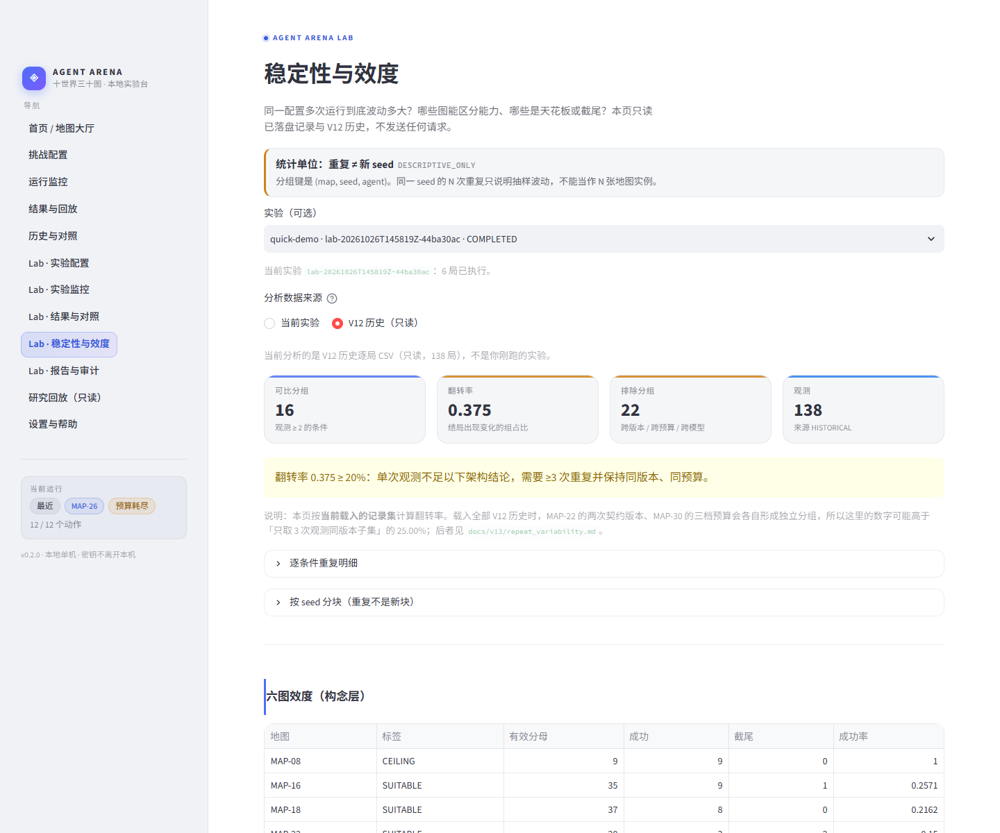
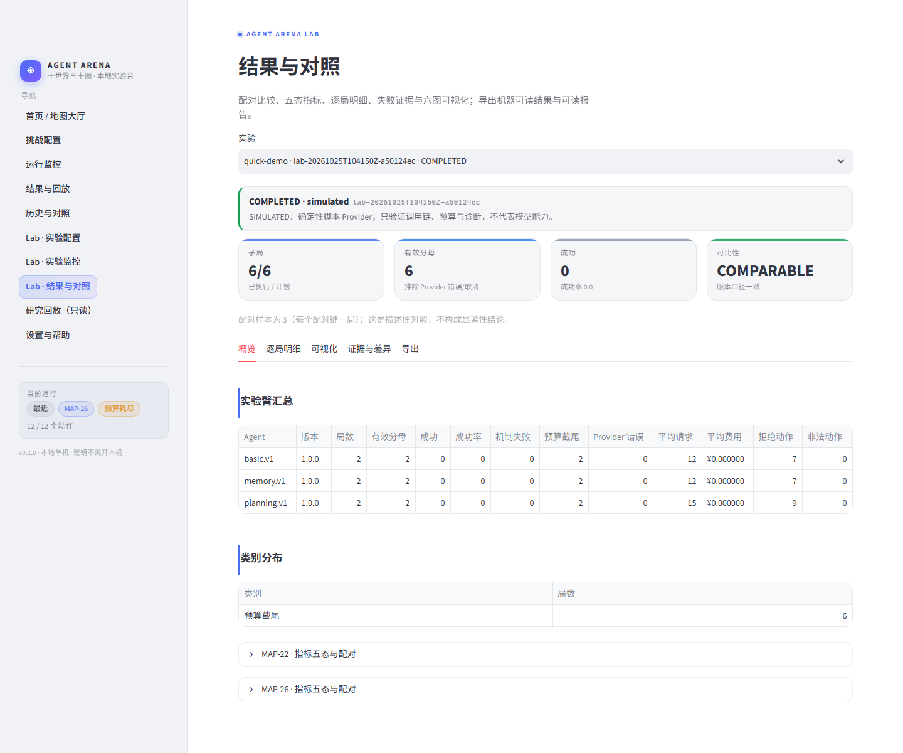

# Agent Arena

Agent Arena 是一个用于学习、运行和比较 LLM Agent 行为的本地实验平台。它在确定、部分可观测的十世界里提供 30 张手工地图，记录每一步的公开观察、动作、结果与指标，并支持在浏览器中选图、配置 seed/预算、启动挑战、实时查看、回放和导出。


## V14.1：第二阶段交付冻结（现状）

第二阶段（V12 Lab 1.0 → V13 Lab 1.1 → V14 Lab 1.2 → V14.1 交付整理）已**冻结**：
状态 `ENGINEERING_VERIFIED` / `EXPLORATORY_COMPLETE` / `LIVE_PARTIAL`
（tag `v14-stage2-exploratory-complete` 为 V14 收尾；V14.1 另打交付 tag）。

```bash
uv run python scripts/verify_v14.py      # 15 项事实边界检查（零请求）
```

在用户授权下完成真实 MiMo 执行 **308 局 / 10 034 请求 / CNY 5.55809328**
（43 个父实验，0 重复结算、0 孤儿；4 次 `unknown_spend` 各自停批、未重试）。

| 策略 | 结论 | 证据 |
|---|---|---|
| `planning.v2` | **唯一可复现的正向结论** | MAP-16 flash `0/25 → 14/21 有效`；**pro `2/12 → 12/12`**（含留出 seed `0/3 → 3/3`）；MAP-18 `2/9 → 4/9`；天花板 MAP-26 `9/9 → 9/9`、地板 MAP-14 `0/9 → 0/9` |
| `memory.v2` `route_log` | **瓶颈是「记了不用」** | 仅 MAP-22 seed 2 且 ≥150 请求 `2/9 → 8/8`；写入在全部 seed 成立（recall 0.19–1.0），但 `route_write_every=1` 把 recall 抬到 0.977 仍不降折返（负向结果） |
| `reflection.v2` | **暴露稳定、效果无可检出差异** | seed 2 上 `trigger_only` 16/35 有效 vs `on` 15/33，Fisher p=1.0；早先 n=13 的「方向性正向」已自我更正 |

**这不是 `STAGE_II_FINAL_READY`**：缺显著性/因果级证据与 Provider 账单核对，
三项非阻断例外已由用户接受。全部结论为描述性（采样支持状态 `UNKNOWN`）。
V14.1 只做交付前审计、数字对账与规范化，**未新增任何付费请求、未改冻结规则**。
详见 [V14.1 验收](docs/v14/V14.1-final-acceptance.md)、[收尾声明](docs/v14/stage2-closure.md)、
[真实结果](docs/v14/live-report.md)、[数字对账](docs/v14/live-numbers-reconciliation.md)、
[最终报告](docs/v14/final-report.md)、[差距清单](docs/v14/gap-audit.md)。

## V13：Agent Arena Lab 1.1（可信、可复现、可诊断）

在 V12 Lab 1.0 之上回答下一层问题：**这些架构差异到底可不可信、机制有没有被激活、
能不能在预算内复现。**

```bash
uv run python scripts/verify_v13.py       # 一键离线验收（18 项，零请求）
uv run python scripts/demo_v13.py         # 零 API Key、零费用的完整演示
```

网页入口：`uv run agent-arena web` → 侧边栏 **Lab · 实验配置 / 实验监控 /
结果与对照 / 稳定性与效度 / 报告与审计**（五页）。



V13 的真实增量（不是重复 V12）：

- **重复身份**：同一条件可在一个实验内做 N 次独立重复（`replicate_index`），
  重复不会被幂等去重，也不会被当成新的环境 seed；
- **可比性协议**：14 维画像 + 单变量检查；多开关同时改会被**拒绝**做因果比较；
  版本比较（`memory.v1 → v2`）与单因子消融被显式区分；
- **采样登记**：temperature / top_p / seed 的支持状态三态；**永不**宣称 deterministic；
- **稳定性分析**：翻转率 + Wilson 描述区间 + 按 seed 分块 + 跨版本排除；
- **三个 v2 策略**：`memory.v2`（只记被接受的移动、`env_write`/`context_only` 显式区分）、
  `planning.v2`（三模式 + TTL + 预算感知）、`reflection.v2`（可验证激活，
  零触发报 `NO_TREATMENT_EXPOSURE`）；
- **七层失败归因**：接口/测量问题**永不**计入能力分母；
- **六维机制画像**：不对 326 个异质指标做平均，缺失机制不补 0；
- **六图构念效度**：`SUITABLE` / `CEILING` / `CENSORED` 复合标签 + 选图建议；
- **模板化报告**：零 LLM，四级结论 + 逐数字锚点，负面结果保留；
- **账本审计**：只读一致性检查 + 可选脱敏账单对账（无账单明确标注）。

**V13 本轮没有新的真实付费请求**（0 局 / CNY 0）；它的三个 v2 策略后来由
[V14](docs/v14/stage2-closure.md) 在独立账本上完成真实对照（308 局 / ¥5.55809328）。
V13 自己的预算申请保留为口径复核记录：[V13 LIVE 预算申请](docs/v13/live-budget-proposal.md)。

详见 [V13 最终报告](docs/v13/final-report.md)、[实验协议](docs/v13/experiment-protocol.md)、
[差距审计](docs/v13/gap-audit.md)、[交付清单](docs/v13/release-checklist.md)。

## V12：Agent Arena Lab 1.0（多架构对照）

同一模型、同一地图、同一 seed、同一预算，比较 **Basic / Memory / Planning** 三种
Agent 架构的行为、成功率、成本与失败原因。

```bash
uv run python scripts/demo_v12.py          # 零 API Key、零费用的完整演示
uv run python scripts/verify_v12.py        # 一键离线验收（15 项）
uv run python scripts/a11y_v12.py --browser --start   # 可访问性审计（需 Playwright）
```

网页入口：`uv run agent-arena web` → 侧边栏 **Lab · 实验配置 / 实验监控 / 结果与对照**。



- 预检**不发任何请求**；真实付费实验必须显式批准（`LiveApproval`），未批准只做预检。
- 子局仍是 V11 的 `runs/web/<run_id>/`，父实验写 `runs/lab/<experiment_id>/`。
- 诊断每条结论都指向具体 `decision` 事件；指标五态不补零、不跨版本求均值。
- `SIMULATED` 结果明确标注"不是模型"，绝不混入真实成绩。

详见 [V12 最终报告](docs/v12/final-report.md)、[实验协议](docs/v12/experiment-protocol.md)、
[指标与归因](docs/v12/metrics-and-attribution.md)、[第三方接入](docs/v12/adapter-api.md)。

## 快速开始（本地网页）

需要 Python 3.13、[uv](https://docs.astral.sh/uv/) 和 Git。

```bash
git clone https://github.com/wenxvn/Agent-Arena.git
cd Agent-Arena
uv sync --extra web
uv run agent-arena web
```

打开 <http://127.0.0.1:8501>。

> 没有安装可选依赖时，也可用：
> `uv run --with streamlit agent-arena web`。

首次使用建议点击首页的 **离线演示：MAP-01 · 破损的曙光号**：

- 不需要 API Key，不联网、不花钱；
- 使用公开规则策略，**不是模型挑战**；
- 可以完整走通：选图 → 运行 → 动作时间线 → 结果 → 回放 → JSON/CSV 导出。

Windows 可用 `powershell -ExecutionPolicy Bypass -File scripts/launch_web.ps1`；macOS/Linux 可用 `./scripts/launch_web.sh`。

## 一键自检

```bash
uv run python scripts/verify_v11.py
```

或：

```bash
uv run agent-arena web --check
```

自检覆盖 30 图 catalog、30 图离线运行/回放/导出、预算门禁、脱敏、路径限制、崩溃恢复与导出字段一致性；不发送 Provider 请求。

## 十世界三十图

| 世界 | 简单 | 中等 | 困难 |
|---|---|---|---|
| 飞船 | MAP-01 破损的曙光号 | MAP-02 双重警报 | MAP-03 最后的百步 |
| 灯塔 | MAP-04 潮汐密道 | MAP-05 三束信号 | MAP-06 暴风眼 |
| 深海站 | MAP-07 阀门方向 | MAP-08 漏点诊断 | MAP-09 深海连锁故障 |
| 极地 | MAP-10 最后一桶燃料 | MAP-11 失联的小队 | MAP-12 极夜三十天 |
| 金字塔 | MAP-13 四神之门 | MAP-14 说谎的祭司 | MAP-15 会变化的迷宫 |
| 地铁 | MAP-16 单线预约与节点容量 | MAP-17 早高峰 | MAP-18 故障传播 |
| 火山 | MAP-19 温度临界点 | MAP-20 冷却网络 | MAP-21 喷发倒计时 |
| 丛林 | MAP-22 无地图的丛林 | MAP-23 迷雾中的遗迹 | MAP-24 消失的道路 |
| 月球 | MAP-25 第一次出舱 | MAP-26 失败的维修计划 | MAP-27 月球车 |
| 古堡 | MAP-28 消失的王冠 | MAP-29 不可靠的证人 | MAP-30 午夜审判 |

`MAP-01`～`MAP-30` 为稳定 ID。设计难度来自 V10；网页另提供人工可解释的 `display_difficulty`，不修改规则或历史数据。

## 接入真实模型

复制模板并在本机 `.env` 填写：

```bash
cp .env.example .env        # macOS / Linux
Copy-Item .env.example .env # Windows PowerShell
```

```dotenv
AGENT_ARENA_PROVIDER=openai
OPENAI_API_KEY=你的密钥
OPENAI_BASE_URL=https://api.xiaomimimo.com/v1
OPENAI_MODEL=mimo-v2.6-flash
```

支持任何 OpenAI-compatible Responses API 网关；也保留本地 Ollama。网页不接受自定义 API URL，密钥只显示“已配置/未配置”。

真实模式默认单局请求 60、费用上限 ¥1.00；只有 MiMo 有登记价时可执行金额硬门禁，其它模型以请求/token 上限为准。未知 usage、超时或连接异常会立即 fail-closed，不自动重试。

## 网页能力

- **地图大厅**：世界/难度/关键词筛选，公开目标、机制、预算、难度说明。
- **挑战配置**：seed、离线/真实模式、Provider/模型、决策/请求/token/费用上限；真实付费前显式确认。
- **运行监控**：状态、进度、实时动作时间线、token/费用、停止；刷新不会重复执行。
- **结果与回放**：成功/失败/截断/取消/中断；指标五态、单位、范围、公式；逐步回放公开 Observation；版本 hash。
- **历史与对照**：按地图/状态/模式/日期/模型筛选；仅同规则/指标版本允许直接对照；本地同模型成绩榜。
- **导出**：回放 JSON、摘要 JSON、逐动作 CSV（UTF-8 BOM）。
- **研究回放（只读）**：保留旧的单局回放、矩阵总览、错误热点、条件对照。
- **Lab 实验配置 / 监控 / 结果（V12）**：多地图 × 多架构 × 多 seed 矩阵，预检零请求、显式费用确认、父子状态、配对对照、五态指标、六图可视化、证据级诊断、Markdown/CSV/JSON 导出。

更多：[快速开始](docs/v11/quickstart.md)、[用户指南](docs/v11/user-guide.md)、[配置](docs/v11/configuration.md)、[网页页面](docs/v11/ui-pages.md)、[安全与预算](docs/v11/safety-and-budget.md)。

## CLI（可选）

```bash
uv run agent-arena run --provider fake          # 确定性 Legacy 演示
uv run agent-arena run --provider ollama --agent memory --output-dir runs
uv run agent-arena benchmark --provider ollama --episodes 3 --output-dir results
uv run agent-arena verify-model --provider ollama
```

原 Legacy/V3 入口、benchmark、失败分析与只读研究视图均保留。

## 数据位置

- 网页运行：`runs/web/<run_id>/`（`manifest.json`、`events.jsonl`、`result.json`）
- V12 父实验：`runs/lab/<experiment_id>/`（`experiment.json`、`manifest.json`、`events.jsonl`、`summary.json`、`comparison.json`、`report.md`、`exports/`）
- V11 账本：`runs/web/_ledger/web_ledger.jsonl`
- 自检报告：`runs/v11/selfcheck.json`、`runs/v12/selfcheck.json`
- 演示数据包（可提交）：`docs/v12/demo/`、`docs/v12/screenshots/`
- 历史研究：`runs/v8/`、`runs/v9/`、`runs/v10/`（只读，不清理）
- `runs/`、`logs/`、`.env` 不入库（本机生成物，`runs/` 含本机绝对路径）
- **`results/` 入库**：只含 `benchmark_v3` / `evaluation_v2` 的聚合 JSON/CSV，
  是 `docs/` 里历史基准数字的可核对来源；规则见 [`results/README.md`](results/README.md)

## 质量门禁

```bash
uv run ruff check .
uv run mypy src
uv run pytest -q
uv run uv lock --check
git diff --check
uv run python -m agent_arena.v10.freeze verify
uv run python -m agent_arena.v10.recompute --check
uv run python -m agent_arena.v10.independent_check --check
uv run python scripts/verify_v11.py
uv run python scripts/verify_v12.py
uv run python scripts/verify_v13.py
uv run python scripts/verify_v14.py
```

当前 V14.1 结果：**1796 pytest passed**（本机；CI 1795 + 1 skipped）、mypy 334 文件 0 issues、ruff clean、lock 0、
freeze 9/9 unchanged、recompute 1093/1093、independent 0 violations、
`verify_v11/12/13/14` = **7/15/18/15**、`lab-e2e` 为阻断门禁（V14.1 提交后远端 CI 两个 Job 均 success）。
详见 [V14 验证报告](docs/v14/validation-report.md)、[V14.1 验收](docs/v14/V14.1-final-acceptance.md)
与 [V14 交付清单](docs/v14/release-checklist.md)。

## 研究背景（简版）

- V10 已完成 30 张原生运行时、154+172 指标、多 seed 基线与 8 项 Gate；30/30 `VALIDATED`（“测得住”，不等于模型能通关）。
- V10 真实 MiMo：152 局有效，成功 57/152；结算 ¥2.27994884 + 未知预留 ¥0.13312000。
- V11 真实 MiMo 冒烟：3 局（MAP-01/19/30），58 次已记录请求，结算 ¥0.04637556，未知预留 ¥0.073728；0 成功为环境规则/预算终局，未修改规则凑成功。
- V12 完成多架构实验层（父实验 + 子局、三种架构 + 反思、六图诊断与可视化、第三方 SDK）；真实 MiMo 共 **20 个实验 / 159 局**，结算 **¥5.43680012**、未知消费 ¥0（批准 ¥6.00）。主矩阵 24/53 成功，同条件重复的结局翻转率 22.2%（2 次观测 4/18）/ 25.0%（3 次观测 3/12）——**1 次/条件不足以为架构排名**。四个测量缺陷（DCR-V12-01…04）与一个"触发器未激活"（DCR-V12-05）都已定位并记录。
- V13 完成 Lab 1.1 深化层（重复身份、可比性协议、三个 v2 策略、七层归因、模板报告、账本审计）；本轮 0 局真实付费请求，全部 LIVE 留给下一轮。
- V14 完成第二阶段探索收尾：修掉 6 个会误导结论的测量口径缺陷、完成 308 局真实 MiMo 对照（¥5.55809328）。结论是 planning 可复现、memory 瓶颈在「记了不用」、reflection 无可检出差异；**不宣称任何架构更优，也不宣称 `STAGE_II_FINAL_READY`**。V14.1 完成交付前审计、LIVE 数字对账（65/83、121/125 等）与规范化封装，第二阶段自此冻结；第三阶段候选尚未启动。
- 完整实验历史见 [开发进度](docs/scope/scope.md)、[工程记录](docs/engineering-log.md)、[V12 真实结果](docs/v12/mimo-results.md) 与 `docs/v8`–`docs/v12`。哪些提纲项没做见 [V12 差距清单](docs/v12/gap-audit.md)。

## 边界

- 单机、单用户、localhost 预览；**不是公网生产环境**。
- 不做登录、云数据库、多用户、付费充值、跨模型排行榜。
- 不修改 V8/V9/V10 冻结规则、账本或历史 trace。
- 30 图规则成功 ≠ 模型能力；Oracle/规则策略不冒充模型。
- macOS/Linux 启动说明已提供，但本次实际运行验证只在 Windows 11 完成。

## 文档入口

- [V14 收尾声明（第二阶段结论）](docs/v14/stage2-closure.md)
- [V14 最终报告](docs/v14/final-report.md)
- [V14 真实结果](docs/v14/live-report.md)
- [V14 差距清单](docs/v14/gap-audit.md)
- [V14 验证报告](docs/v14/validation-report.md)
- [V13 最终报告](docs/v13/final-report.md)
- [V12 最终报告](docs/v12/final-report.md)
- [V12 实验协议](docs/v12/experiment-protocol.md)
- [V12 指标与归因](docs/v12/metrics-and-attribution.md)
- [V12 真实结果](docs/v12/mimo-results.md)
- [V12 开关消融](docs/v12/ablations.md)
- [V12 差距清单](docs/v12/gap-audit.md)
- [V12 第三方接入 API](docs/v12/adapter-api.md)
- [V12 验证报告](docs/v12/validation-report.md)
- [V11 快速开始](docs/v11/quickstart.md)
- [V11 用户指南](docs/v11/user-guide.md)
- [V11 最终报告](docs/v11/final-report.md)
- [V11 发布检查清单](docs/v11/release-checklist.md)
- [架构摘要](docs/architecture.md)
- [开发进度](docs/scope/scope.md)
- [研究总纲](研究总纲.md)
