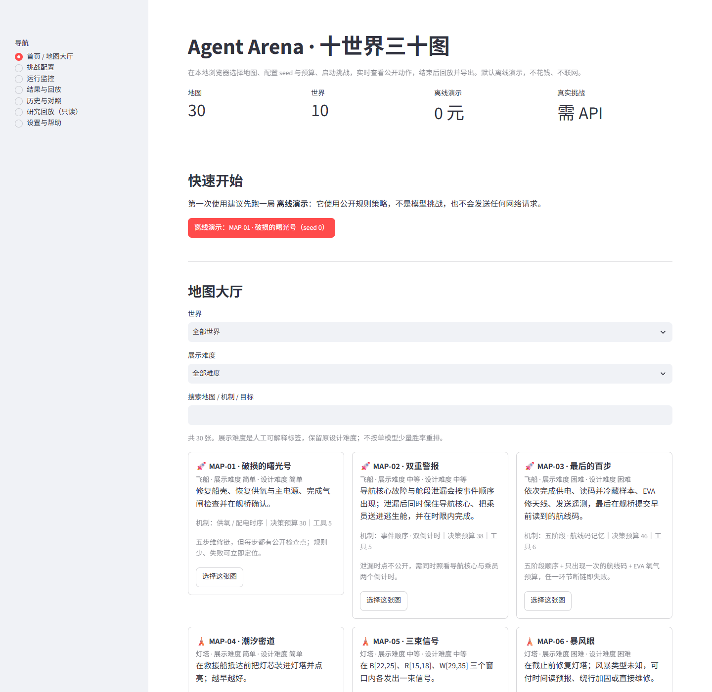

# Agent Arena

Agent Arena 是一个用于学习、运行和比较 LLM Agent 行为的本地实验平台。它在确定、部分可观测的十世界里提供 30 张手工地图，记录每一步的公开观察、动作、结果与指标，并支持在浏览器中选图、配置 seed/预算、启动挑战、实时查看、回放和导出。



## 快速开始（本地网页）

需要 Python 3.13、[uv](https://docs.astral.sh/uv/) 和 Git。

```bash
git clone https://github.com/wenxvn/Agent-Arena.git
cd Agent-Arena
uv sync --extra web
uv run agent-arena web
```

打开 <http://127.0.0.1:8501>。

> 没有安装可选依赖时，也可用：
> `uv run --with streamlit agent-arena web`。

首次使用建议点击首页的 **离线演示：MAP-01 · 破损的曙光号**：

- 不需要 API Key，不联网、不花钱；
- 使用公开规则策略，**不是模型挑战**；
- 可以完整走通：选图 → 运行 → 动作时间线 → 结果 → 回放 → JSON/CSV 导出。

Windows 可用 `powershell -ExecutionPolicy Bypass -File scripts/launch_web.ps1`；macOS/Linux 可用 `./scripts/launch_web.sh`。

## 一键自检

```bash
uv run python scripts/verify_v11.py
```

或：

```bash
uv run agent-arena web --check
```

自检覆盖 30 图 catalog、30 图离线运行/回放/导出、预算门禁、脱敏、路径限制、崩溃恢复与导出字段一致性；不发送 Provider 请求。

## 十世界三十图

| 世界 | 简单 | 中等 | 困难 |
|---|---|---|---|
| 飞船 | MAP-01 破损的曙光号 | MAP-02 双重警报 | MAP-03 最后的百步 |
| 灯塔 | MAP-04 潮汐密道 | MAP-05 三束信号 | MAP-06 暴风眼 |
| 深海站 | MAP-07 阀门方向 | MAP-08 漏点诊断 | MAP-09 深海连锁故障 |
| 极地 | MAP-10 最后一桶燃料 | MAP-11 失联的小队 | MAP-12 极夜三十天 |
| 金字塔 | MAP-13 四神之门 | MAP-14 说谎的祭司 | MAP-15 会变化的迷宫 |
| 地铁 | MAP-16 单线预约与节点容量 | MAP-17 早高峰 | MAP-18 故障传播 |
| 火山 | MAP-19 温度临界点 | MAP-20 冷却网络 | MAP-21 喷发倒计时 |
| 丛林 | MAP-22 无地图的丛林 | MAP-23 迷雾中的遗迹 | MAP-24 消失的道路 |
| 月球 | MAP-25 第一次出舱 | MAP-26 失败的维修计划 | MAP-27 月球车 |
| 古堡 | MAP-28 消失的王冠 | MAP-29 不可靠的证人 | MAP-30 午夜审判 |

`MAP-01`～`MAP-30` 为稳定 ID。设计难度来自 V10；网页另提供人工可解释的 `display_difficulty`，不修改规则或历史数据。

## 接入真实模型

复制模板并在本机 `.env` 填写：

```bash
cp .env.example .env        # macOS / Linux
Copy-Item .env.example .env # Windows PowerShell
```

```dotenv
AGENT_ARENA_PROVIDER=openai
OPENAI_API_KEY=你的密钥
OPENAI_BASE_URL=https://api.xiaomimimo.com/v1
OPENAI_MODEL=mimo-v2.6-flash
```

支持任何 OpenAI-compatible Responses API 网关；也保留本地 Ollama。网页不接受自定义 API URL，密钥只显示“已配置/未配置”。

真实模式默认单局请求 60、费用上限 ¥1.00；只有 MiMo 有登记价时可执行金额硬门禁，其它模型以请求/token 上限为准。未知 usage、超时或连接异常会立即 fail-closed，不自动重试。

## 网页能力

- **地图大厅**：世界/难度/关键词筛选，公开目标、机制、预算、难度说明。
- **挑战配置**：seed、离线/真实模式、Provider/模型、决策/请求/token/费用上限；真实付费前显式确认。
- **运行监控**：状态、进度、实时动作时间线、token/费用、停止；刷新不会重复执行。
- **结果与回放**：成功/失败/截断/取消/中断；指标五态、单位、范围、公式；逐步回放公开 Observation；版本 hash。
- **历史与对照**：按地图/状态/模式/日期/模型筛选；仅同规则/指标版本允许直接对照；本地同模型成绩榜。
- **导出**：回放 JSON、摘要 JSON、逐动作 CSV（UTF-8 BOM）。
- **研究回放（只读）**：保留旧的单局回放、矩阵总览、错误热点、条件对照。

更多：[快速开始](docs/v11/quickstart.md)、[用户指南](docs/v11/user-guide.md)、[配置](docs/v11/configuration.md)、[网页页面](docs/v11/ui-pages.md)、[安全与预算](docs/v11/safety-and-budget.md)。

## CLI（可选）

```bash
uv run agent-arena run --provider fake          # 确定性 Legacy 演示
uv run agent-arena run --provider ollama --agent memory --output-dir runs
uv run agent-arena benchmark --provider ollama --episodes 3 --output-dir results
uv run agent-arena verify-model --provider ollama
```

原 Legacy/V3 入口、benchmark、失败分析与只读研究视图均保留。

## 数据位置

- 网页运行：`runs/web/<run_id>/`（`manifest.json`、`events.jsonl`、`result.json`）
- V11 账本：`runs/web/_ledger/web_ledger.jsonl`
- 自检报告：`runs/v11/selfcheck.json`
- 历史研究：`runs/v8/`、`runs/v9/`、`runs/v10/`（只读，不清理）
- `runs/`、`results/`、`logs/`、`.env` 均不入库

## 质量门禁

```bash
uv run ruff check .
uv run mypy src
uv run pytest -q
uv run uv lock --check
git diff --check
uv run python -m agent_arena.v10.freeze verify
uv run python -m agent_arena.v10.recompute --check
uv run python -m agent_arena.v10.independent_check --check
```

当前 V11 结果：1240 pytest passed、mypy 0 issues、ruff clean、lock 0、freeze 9/9 unchanged、recompute 1093/1093、independent 0 violations。详见 [测试报告](docs/v11/test-report.md)。

## 研究背景（简版）

- V10 已完成 30 张原生运行时、154+172 指标、多 seed 基线与 8 项 Gate；30/30 `VALIDATED`（“测得住”，不等于模型能通关）。
- V10 真实 MiMo：152 局有效，成功 57/152；结算 ¥2.27994884 + 未知预留 ¥0.13312000。
- V11 真实 MiMo 冒烟：3 局（MAP-01/19/30），58 次已记录请求，结算 ¥0.04637556，未知预留 ¥0.073728；0 成功为环境规则/预算终局，未修改规则凑成功。
- 完整实验历史见 [开发进度](docs/scope/scope.md)、[工程记录](docs/engineering-log.md) 与 `docs/v8`–`docs/v10`。

## 边界

- 单机、单用户、localhost 预览；**不是公网生产环境**。
- 不做登录、云数据库、多用户、付费充值、跨模型排行榜。
- 不修改 V8/V9/V10 冻结规则、账本或历史 trace。
- 30 图规则成功 ≠ 模型能力；Oracle/规则策略不冒充模型。
- macOS/Linux 启动说明已提供，但本次实际运行验证只在 Windows 11 完成。

## 文档入口

- [V11 快速开始](docs/v11/quickstart.md)
- [V11 用户指南](docs/v11/user-guide.md)
- [V11 最终报告](docs/v11/final-report.md)
- [V11 发布检查清单](docs/v11/release-checklist.md)
- [架构摘要](docs/architecture.md)
- [开发进度](docs/scope/scope.md)
- [研究总纲](研究总纲.md)
