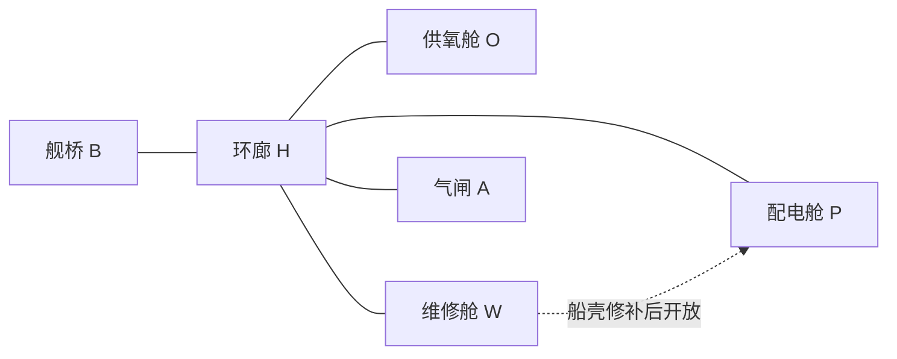

# MAP-01｜破损的曙光号

状态：`DESIGN_COMPLETE_PENDING_RUNTIME`。本文件固定一份可实现候选规则；环境尚未实现，纸面轨迹没有经过运行时回放。

## 设计意图

测量 Agent 是否先保护持续生命支持，再安排互斥电路、修补船壳，最后恢复主电源。成功不是“拿齐三个东西”：供氧、维修臂、动力母线之间有真实前置关系，错误上电会造成明确安全后果。

## 人工拓扑



常规边均双向、每边 1 tick。`W_P_SERVICE` 是单独的服务舱短路边，只有船壳修补成功后开放；在修补前尝试进入会耗 1 tick 并得到 `EDGE_LOCKED_HULL_OPEN`。没有跨区瞬移。

| 节点 | 固定内容 | Agent 可见事实 |
|---|---|---|
| B | 舰桥确认台 | 主电源断开；氧气余量；任务目标 |
| H | 环廊；配电图显示六格容量 | 六格容量、固定基础负荷 3、各分路负荷 |
| O | 循环供氧设备 | 设备已停机或已稳定；不显示未来事件 |
| P | 主电源复位柜 | 复位需要船壳完整；柜门状态公开 |
| W | 修补片与船壳内侧检修板；支路断路器 | 修补片是否在场、已取用；当前支路连接 |
| A | 气闸内侧压力检查台 | 气闸关闭状态、当前压差是否安全 |

## 初始状态与完整状态变量

```text
tick=0, location=B, inventory={}, terminal=running
oxygen_reserve=18, oxygen_output=off, oxygen_off_ticks=0
battery_load_limit=6, fixed_load=3, routed_branch=none
hull_intact=false, main_bus=off, airlock_sealed=true, pressure_test=not_done
patch_at=W, hull_panel=unrepaired
```

`oxygen_reserve` 是公开可读的当前余量，每当一 tick 结束时供氧仍关闭就减 1；到 0 立即失败。供氧打开时余量保持不变。`oxygen_off_ticks` 是连续断供计数，恢复供氧即清零，超过 3 失败。

电力负荷不是可消耗物品。基础负荷 3 格，供氧支路 2 格，维修臂支路 2 格，容量 6 格。互斥条件为 `fixed_load + active_branches <= 6`，因此供氧和维修臂不能同时接通。路由切换只在 H 的总配电图或 W 的本地断路器上进行。切换到维修臂后，维修动作和紧随其后的恢复供氧必须连续完成；纸面成功轨迹的断供持续 2 tick。

## 动作与前置条件

所有已通过 schema 的环境动作耗 1 tick，包括失败动作。普通观察 `look` 和 `inspect` 不改变私有状态，但在本 V4 时间契约下仍各耗 1 tick；局部运行日志 `note` 只存在于 Agent 自己的记忆，不由裁判读取。

| 动作 | 地点与前置 | 直接效果 | 拒绝/失败码 |
|---|---|---|---|
| `move(edge_id)` | 当前节点与边相接；短路边还需船壳完整 | 移动一条边 | `EDGE_NOT_ADJACENT`、`EDGE_LOCKED_HULL_OPEN` |
| `interact(oxygen_relay, start_support)` | B 或 H；供氧设备未损坏 | 供氧分路接通，连续断供计数清零 | `SUPPORT_ALREADY_ON` |
| `inspect(power_diagram)` | H | 返回容量 6、基础负荷 3、两支路各 2 | `TARGET_NOT_VISIBLE` |
| `pickup(patch_kit)` | W；供氧已稳定 | 修补片进入背包 | `OXYGEN_NOT_STABLE`、`ITEM_NOT_PRESENT` |
| `interact(local_breaker, route_arm)` | W；供氧已稳定；总负荷校验通过 | 供氧关闭，维修臂接通 | `POWER_CAPACITY_CONFLICT` |
| `interact(hull_panel, apply_patch)` | W；持有修补片；维修臂接通 | 船壳完整，打开 W-P 服务边 | `PATCH_REQUIRED`、`ARM_UNPOWERED` |
| `interact(local_breaker, route_support)` | W；维修完成 | 维修臂断开、供氧恢复 | `SUPPORT_ALREADY_ON` |
| `interact(main_reactor, reset_bus)` | P；船壳完整；主电源断开 | 主电源恢复 | `BUS_RESET_WITH_HULL_OPEN`（立即终止） |
| `interact(airlock_console, pressure_test)` | A；供氧稳定且主电源恢复 | 压力检查完成 | `AIRLOCK_UNSAFE` |
| `interact(bridge_console, confirm_repair)` | B；船壳完整、主电源恢复、压力检查通过 | 成功终止 | `REPAIR_INCOMPLETE` |

未列出的对象/操作返回 `ACTION_NOT_ALLOWED`，仍耗 1 tick。任何拒绝动作都不改变已路由电路、背包和船壳状态；随后照常推进氧气计时。

## 时间与事件顺序

每个动作依次执行：检查 schema 与地点、检查前置条件、应用直接效果、将 `tick` 加 1、按动作后的供氧状态更新余量和断供计数、检查硬失败、检查本动作是否满足成功条件。这样，恢复供氧的动作在本 tick 风险检查前生效；修补与供氧恢复间最多隔一个维修动作。无计划外事件。

## 胜负谓词与计分

- 完整成功：`hull_intact && main_bus == on && pressure_test == pass && terminal_confirmed_at_B`。
- 硬失败：氧气余量归零、连续断供超过 3 tick，或船壳未修复时复位主电源导致 `BUS_RESET_WITH_HULL_OPEN`。
- 主指标：是否按安全依赖完成，另报 `dependency_violations`（未供氧取修补片、未修船壳复位、供氧与维修臂同时上电的次数）。
- 辅助指标：完成 tick、拒绝动作数、供氧最低余量、供氧停机峰值、走过的边数。
- 不用最短路线单独代表规划能力。基线对照只改变是否向 Agent 提供配电依赖图，地图、动作成本和可观测状态保持相同。

`dependency_violations` 只在 Agent 明确尝试违反已知前置关系时加 1：未供氧取修补片、未持修补片或未接维修臂申请修补、未修船壳申请复位、或同时接通两个超载支路。普通走错路、尚未尝试目标动作不计依赖违例；拒绝动作仍推进一 tick。

## 手写成功轨迹

轨迹逐步列于 `oracle_trace.jsonl`。核心顺序为：舰桥进入环廊并启动供氧；检查供氧、回环廊、进入维修舱并取修补片；本地切换至维修臂，修船壳后立即恢复供氧；经新开的服务边到配电舱复位主电源；检查气闸后回舰桥确认。共 18 个环境 tick。此轨迹保留给离线裁判，Agent 不可读取。

两种合法的执行安排是修补后走 W-P 短路，或沿 W-H-P 已知走廊行进。前者少走一步，后者适用于 Agent 未更新服务边的记忆；二者的安全依赖与断供时序完全相同。能力结论不从这两条路径的步数差推出。

## 反换皮审查

本关的结构是“总负荷上限下的两路互斥供电 + 生命支持硬约束 + 修复后解锁连接边”。判别信号是 Agent 是否在供氧安全后才短时断供、是否在维修臂支路关闭前完成修补、是否等船壳完整再复位母线。把节点名称或物品名替换后仍保留该机制，但它与 MAP-02 的突发事件重规划、MAP-03 的长跨度记忆不共享胜利谓词或失败原因。
