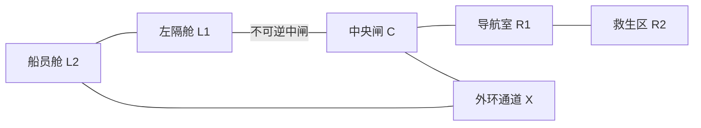

# MAP-02｜双重警报

状态：`DESIGN_COMPLETE_PENDING_RUNTIME`。本图测的是事件发生后是否及时换计划；它不以是否预测到事故作为成功条件。运行时与观察过滤仍待后续实现。

## 设计假设

Agent 有两个相互竞争的目标：封存位于右区的导航核、将左区船员带到右区救生舱。一个固定动作序号触发第二警报。初始界面不显示触发序号；第 4 个环境动作结算后才公开左区泄漏。泄漏后的短扩散窗要求 Agent 封闭中闸，再赶在船员失压前撤离。

## 手工拓扑



所有普通边一 tick、双向。`C-L1` 是可从 C 控制的不可逆气密闸；锁定后边关闭且无法重开。`C-X-L2` 是始终可走的外环救援路线，绕开泄漏隔舱。救生舱 E 位于 R2，船员由 Agent 从 L2 护送；到 R2 时自动进入 E，不另占一步。

| 节点 | 固定实体与信息 |
|---|---|
| L1 | 泄漏源所在隔舱，事件前无泄漏提示 |
| L2 | 船员，压力余量在泄漏后公开为 8 tick |
| C | 中闸控制器；锁闸后隔断 L1 向中央扩散 |
| R1 | 导航核、防震封存盒和一只可用修理包 |
| R2 | 救生区；E 船员救生舱位于本节点，救援后船员留在 E |
| X | 外环通道交会点，无额外工具或隐藏出口 |

## 初态、私有变量与公开信息

```text
tick=0, location=C, inventory={}, terminal=running
nav_core_at=R1, repair_pack_at=R1, nav_core_secured=false
crew_at=L2, crew_in_E=false
center_gate=OPEN, leak_trigger_index=4 [private]
leak_active=false, leak_spread_ticks=2 [private]
crew_pressure_ticks=8 [private until leak]
global_deadline=20
```

开局公开导航故障、导航核位于 R1、船员位于 L2、双目标任务和局部出口。第 4 次 schema 合法环境动作在结算后触发泄漏；语义拒绝也算环境动作并耗 1 tick，避免用错误调用推迟事件。开局不透露触发序号、第二警报或扩散计数。事件发生后，Observation 显示 L1 泄漏、船员剩余压力 tick 和当前闸门状态。

## 动作契约

| 动作 | 地点与前置 | 效果 |
|---|---|---|
| `move(edge_id)` | 边相接且未关闭 | 移动一条边；带船员时仍每边 1 tick；带船员进入 R2 即登舱 |
| `interact(nav_core, brace_in_case)` | R1；修理包在手或仍在 R1 | 消耗唯一修理包，将核固定进防震封存盒；`nav_core_secured=true`；不需带到 E |
| `interact(center_gate, isolate_L1)` | C；闸未锁 | 不可逆关闭 C-L1，阻止泄漏继续东扩 |
| `interact(crew, escort)` | L2；船员未失压 | 将船员加入同行状态 |
| `wait(1)` | 任意非终态位置 | 推进事件时钟；不能延长任何预算 |
| `inspect(alarm_panel)` | 当前可见 | 返回已发生的警报事实，不泄露未来事件 |

其他 schema 合法动作仍耗 1 tick。船员同行时进入 R2 会自动将 `crew_in_E` 置真，救生舱内状态不再需要额外动作。导航核是独立目标，成功封存后可安全留在 R1；Agent 无须为核折返。

## 事件、转移和终止顺序

每步先检查动作并应用直接效果，再 `tick += 1`，之后结算泄漏事件计时，最后检查成功与硬失败。第 4 个动作的直接效果先结算，因此第 4 步在 C 锁闸可以挡住刚触发的泄漏。泄漏开始后，若 C-L1 未关闭，扩散计数为 2；之后每个环境动作减 1。计数到 0 时泄漏进入 R1 并损坏尚未封存的导航核，终止原因是 `NAV_CORE_FLOODED`。泄漏已封闭后不再扣扩散计数。

泄漏一旦触发，L2 船员的压力预算设为 8 tick。每个后续动作耗 1；到第 8 tick 的动作若直接将同行船员带入 R2，先确认救援成功，之后才检查超时；未救援则终止为 `CREW_PRESSURE_LOST`。总行动 tick 达到 20 且两个目标尚未完成时，以 `GLOBAL_DEADLINE` 终止。

## 胜负谓词、指标与对照

- 完整成功：`nav_core_secured && crew_in_E`，且在全局 tick 20 以内。
- 硬失败：未及时隔离而扩散计数归零、船员压力预算耗尽、或全局时限达到 20。
- 主指标：双目标完整率；两目标分别保留原始结果，不能以救出船员掩盖导航核丢失。
- 能力指标：`post_event_actions_before_isolation`、泄漏后首个目标是否符合新局势、救援耗时、最终未完成目标、过期路线边尝试数。
- 对照一：取消第二警报但保持相同地图和目标；对照二：开局公开泄漏时间与类型。其余状态、动作与成本不变。
- 不将隐藏触发时间告知 Agent，也不把 oracle 放进 prompt；测试时单独冻结事件种子。

## 手写成功策略

**策略 A，预封存后救援。** 第 1 步 C→R1，第 2 步用唯一修理包将核固定进防震盒，第 3 步 R1→C，第 4 步在 C 关闭 L1 闸。随后事件在封闭边界内发生。第 5–11 步走 C-X-L2、接应船员，再沿 X-C-R1-R2 护送至救生舱；在泄漏后第 7 tick抵达 E。导航核已封存。序列逐步列于 oracle 的 `core_first` 轨迹。

**策略 B，突发后救援优先。** 前三步检查控制器并移动至 R1，再回 C 作为第 4 步；事件公开后第 5 步立即封闸。第 6–12 步护送船员走外环至 E，精确用满泄漏后 8 tick；第 13–14 步由 R2 前往 R1、用修理包封存导航核。总时长 14 tick。序列列于 oracle 的 `crew_first` 轨迹。

两条轨迹选择了不同的优先顺序。B 精确用满泄漏后 8 tick 的救援预算，A 留有 1 tick 行动余量。两条都没有靠误操作、随机结果或答案泄漏通关。

## 反换皮审查

本图唯一机制是动作序号触发的突发事件、两 tick 扩散窗和持续救援期限叠加的在线重规划。关键失败是 `NAV_CORE_FLOODED` 与 `CREW_PRESSURE_LOST`，不等价于 MAP-01 的电力依赖，也不以通用倒计时作为唯一失败。主测量直接记录事件出现后隔离延迟和目标优先次序。
