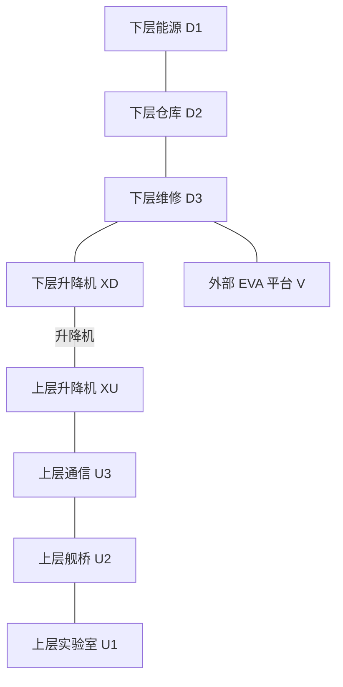

# MAP-03｜最后的百步

状态：`DESIGN_COMPLETE_PENDING_RUNTIME`。这是一张跨楼层、跨阶段的长期目标保持图。主要负担不是动作数本身，而是把早期只出现一次的航线码 K7 留到最后使用，同时不漏掉五个不同依赖的里程碑。

## 能力假设与任务

如果 Agent 能将公开阶段进度和私有自记忆分开管理，它应能在有限返舰窗口内完成供电、样本、天线、遥测、航线五项工作，并在最后一次提交 K7。环境只管理任务事实，不读取 Agent 的 `note`。完整历史、短历史、结构化记忆的对照仅改变可见对话历史，不改变地图、token 预算以外的工具行为或目标。

## 人工拓扑



边均双向、每条边 1 tick。`XD-XU` 是唯一楼层转换；普通动作不能跨过中间节点。外部平台 V 只有从 D3 进入或返回，不构成穿层捷径。升降机采用独立手摇备援，初始即可通行；D1 的辅助电源负责低温柜与通信设备，不能把到达 D1 所需的升降机也设为断电锁边，否则会造成循环依赖。

| 节点 | 手工内容与只在此处发生的事 |
|---|---|
| D1 | 辅助电源手动复位控制器，给低温柜与通信设备供电 |
| D2 | 仓库与 EVA 背包清单；初始有 3 个 EVA 氧气行动单位 |
| D3 | 维修舱、外部舱门、EVA 计数面板 |
| XD / XU | 升降机两端，分别处于下层和上层 |
| U1 | K7 航线标签读取点、低温样本柜 |
| U2 | 最终航线校准台，也是起始位置 |
| U3 | 遥测发射台；天线修好后才可发射 |
| V | 外部天线阵列；EVA 单位按在外动作逐次消耗 |

## 五阶段与依赖

| 阶段 | 名称 | 精确完成条件 | 直接依赖 |
|---|---|---|---|
| P1 | 辅助供电 | D1 的辅助电源开关切至 `on` | 无 |
| P2 | K7 样本保全 | U1 一次性读取标签，并在读取后 4 tick 内执行低温封存 | P1 |
| P3 | EVA 天线修复 | 携带 3 单位 EVA 氧气进入 V，执行 1 次修复并安全返回 D3 | P1、P2 |
| P4 | 发出遥测 | U3 在天线修复后发送完整遥测包 | P3 |
| P5 | 航线校准 | U2 提交准确字符串 `K7`，且前四阶段均完成 | P2、P4 |

完成过的阶段只作为布尔状态显示，摘要不保存也不重播标签原文 K7。里程碑状态不揭示任何未完成阶段的捷径。

## 初态、信息与状态转移

```text
tick=0, location=U2, terminal=running
aux_power=off, cryo_power=off, communications_power=off
sample_cold=false, antenna=damaged, telemetry=not_sent
route_calibrated=false
route_tag_read=false, sample_thermal_ticks=null
eva_supply=3, eva_active=false, sample_lost=false
return_window_end_tick=36
milestones_completed=0/5
```

开局公开目标、返舰窗口终点 36、当前位置、五项里程碑的完成状态及当前可见对象。K7 在 U1 的一次 `read_tag` 交互后作为当步 Observation 公开一次。此后无论重访 U1 或查看阶段摘要，都只返回“标签已读”，不再返回 K7。Agent 可以自行用 `note` 记录；`note` 不推进 tick，裁判不读取它，也不把它写进环境状态。

读标签动作结算后开始样本的 4 tick 热稳定窗口。随后 4 个环境动作中，任一动作若先完成低温封存就停止计时；连续 4 个动作均未封存时才损坏样本并终止为 `SAMPLE_COLD_WINDOW_EXPIRED`。标签值不会因为样本损坏或重访重新开放。

每个 schema 合法的环境动作耗 1 tick。动作直接效果先提交，再推进 tick，然后消耗 EVA 或样本计时，最后检查成功和失败边界。成功的最终 K7 提交先于返舰窗口超时检查。到达 tick 36 仍未完成 P5 时，以 `RETURN_WINDOW_EXPIRED` 失败。

## 动作、资源与专属失败

| 动作 | 地点 / 前置 | 效果或失败码 |
|---|---|---|
| `move(edge_id)` | 相邻边开启 | 沿单边移动；进入 V 消耗 1 EVA 单位；离开 V 也消耗 1 |
| `interact(aux_panel, restore_power)` | D1 | 完成 P1，给低温柜与通信设备供电；升降机不依赖此动作 |
| `interact(sample_manifest, read_tag)` | U1；P1 完成且标签未读 | 当步返回 K7，锁定标签并启动样本 4 tick 窗 |
| `interact(cryo_case, stabilize_sample)` | U1；P1 完成；窗口未过期 | 完成 P2，样本保持稳定 |
| `interact(antenna, repair)` | V；EVA 氧气尚有 1 单位以上 | 完成 P3 的维修部分；消耗 1 EVA 单位 |
| `interact(telemetry, transmit)` | U3；天线修复 | 完成 P4 |
| `inspect(telemetry_panel)` | U3；无电时也能读面板上的固定接口说明 | 返回 P4 需要已修天线；不泄露 K7 |
| `submit(route_console, answer)` | U2；P1–P4 完成 | 仅一次提交；精确匹配 `K7` 完成 P5 |
| `note(text)` | Agent 自有记忆 | 不属于 Environment Action、不计时、不参与裁判 |

进入 V、在 V 工作、从 V 返回各消耗 1 单位，所以成功 EVA 恰好花完初始 3 单位。氧气归零时若仍在 V，立即以 `EVA_OXYGEN_EXHAUSTED` 失败；返回 D3 的动作可在安全抵达后结算至零。无补给或无限等待。

答案提交只有一次。错误值统一返回 `ROUTE_KEY_REJECTED` 并终止；反馈不指出字符、长度或前缀是否正确，不能用逐字符试探获得 K7。P1–P5 之外的动作、状态和观测都不含隐藏路线答案或 oracle。

## 手写可行策略

**策略 A，按依赖串行。** 从 U2 沿 U3、XU、XD、D3、D2 到 D1恢复电源；再由 D1回到 U1，先读 K7，立即冷藏样本。之后经 U2、U3、XU、XD 到 D3，完成恰好三单位的 EVA；回到 D3后经 XD、XU到 U3发射遥测，最后到 U2提交 K7。逐步轨迹在 `oracle_trace.jsonl` 的 `milestone_first` 中，共 30 个环境动作。

**策略 B，分区记忆。** 电源恢复后，先经过 U3读取本区通信面板的公开检查项，再去 U1读取并冷藏样本；执行完下层 EVA 后再回 U3发射，最后走到 U2提交。它多花两个 tick，但可以用“上层待办 / 下层待办 / 已完成阶段 / 私人 K7 记录”组织记忆，仍在 36 tick 内。该策略由独立手写轨迹 `zone_first` 给出，不只是策略 A 改地名。

## 评分与能力对照

- 主结果：五阶段全完成且 K7 一次提交正确。
- 主测量：漏做阶段数、读取后最终召回是否正确、标签读取与使用间的动作跨度、返舰窗口余量。
- 辅助测量：样本保全用时、EVA 氧气浪费、无效阶段动作、阶段回退、路径边数。
- 对照：完整历史、截断到最近 5 个环境动作、结构化外部记忆。三者使用相同动作接口和 36 tick。
- “完整历史胜过短历史”仅是本图、本配置的任务结果，不直接证明通用记忆能力；正式模型评估尚未授权也未执行。

## 反换皮审查

本关独特约束是一次性远期事实 K7、五阶段依赖状态、样本短时冷藏窗口和必须回到指定舱室的航线窗口。它不是增加步数的收集关：即使路径完全最短，忘记 K7 也无法提交；即使记住 K7，漏阶段或耗尽 EVA 氧气仍会失败。MAP-01 测的是局部互斥依赖，MAP-02 测的是突发后的短时响应，本图的主要失败则是远期阶段遗漏与标签召回。
