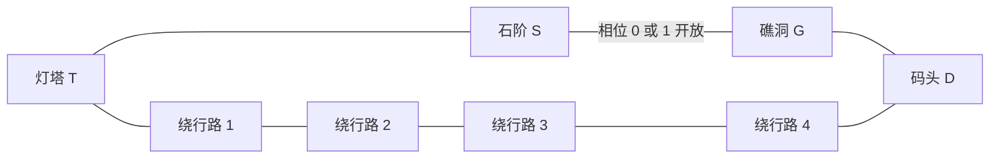

# MAP-04｜潮汐密道

状态：`DESIGN_COMPLETE_PENDING_RUNTIME`。本图只测周期预测与跨动作时序。潮汐规则公开，Agent 需要根据当前相位推算能否进入和离开狭窄潮道；不加入随机天气或隐藏的相位变化。

## 人工拓扑



每条边双向、1 tick。`T-S-G-D` 是短路；`T-B1-B2-B3-B4-D` 恰有 5 条边，是潮道关闭时始终可用的绕路。灯芯固定放在 G。没有其他连边或瞬移。

| 区域 | 固定用途 | 相位影响 |
|---|---|---|
| T | 灯塔灯座与点灯控制 | 无 |
| S | 潮道入口石阶 | 可等候，潮道相位照常推进 |
| G | 安全礁洞与灯芯 | 可安全等候；S-G 是否开放仍由出发相位决定 |
| D | 潮道另一端码头 | G-D 常开；去 T 必须走五边绕路 |
| B1–B4 | 海岸绕行路 | 任意相位均开放，每边一 tick |

## 初态与潮汐时钟

```text
tick=0, location=T, tide_phase=2, tide_period=6
S_G_open_phases=[0,1], wick_at=G, wick_carried=false
lamp_wick_fitted=false, lamp_lit=false, rescue_deadline_tick=18
```

`tide_phase` 是公开状态，开局同时公开周期 6 与开放相位 0、1；不公开未来相位表。任何 schema 合法环境动作都耗 1 tick，并令 `phase=(phase+1) mod 6`。移动先按动作开始时的相位检查边，再应用移动，再推进相位。尝试关闭中的 S-G 会返回 `TIDE_WINDOW_CLOSED`、留在原地，但仍耗 1 tick 并推进相位。`inspect(tide_gauge)` 只报告当前相位，不提供未来序列；反复查询不增加信息。

在 G 等候不会让 Agent 溺水，也不会暂停潮汐。窗口错过后可等下个周期或改走 D 的绕路。目标是在救援船抵达前把灯芯安装并点亮；tick 18 结算结束仍未点灯即失败。成功动作先于同 tick 截止检查。

## 动作与规则

| 动作 | 地点与条件 | 直接结果 |
|---|---|---|
| `move(edge_id)` | 当前边相邻；S-G 另需出发相位为 0 或 1 | 沿一边移动 |
| `inspect(tide_gauge)` | S、G、D 或 T 的潮位标牌可见时 | 返回当前相位，耗 1 tick |
| `pickup(wick)` | G 且灯芯仍在原处 | 灯芯进入背包 |
| `interact(lamp, fit_wick)` | T；持有灯芯且尚未安装 | `lamp_wick_fitted=true` |
| `interact(lamp, ignite)` | T；灯芯已安装 | `lamp_lit=true`，成功终止 |
| `wait(1)` | 任意非终态节点 | 不移动，耗 1 tick，推进潮相 |

灯芯一旦取走不被潮水销毁；失败尝试也不移除灯芯。这样失败归因于相位推算与时限，而不是隐式损失规则。`inspect` 与规则层可识别但不满足前置条件的动作都按统一时钟推进。此图不定义独立 `look` 动作；当前位置、相邻出口和当地可见对象由 `observe()` 提供，避免额外查询接口造成不一致。

## 手写成功轨迹

**策略 A，利用潮道。** T-S 后相位变为 3，在 S 等 3 tick 到相位 0；S-G 于相位 0 通过，进入 G 后相位 1。取灯芯后相位 2，在 G 等 4 tick 到相位 0，再沿 G-S、S-T 返回。安装并点灯。共 14 tick，逐动作相位见 `oracle_trace.jsonl` 的 `tide_window`。

**策略 B，完全绕行。** T-B1-B2-B3-B4-D-G 取灯芯，再 G-D-B4-B3-B2-B1-T 返回，最后安装并点灯，共 15 tick。路径不依赖任何窗口，时间仍低于 18。它用多一条行动余量换取不必预测潮道的确定性。

## 失败路径与评分

三条手写失败路径放在 `failure_traces/cases.yaml`：停留不行动导致救援船抵达、完成五边绕行并装芯后把剩余时间花在等待上、在礁洞连续查询潮位后于 tick 18 才回到灯塔路线。第三条精确终止于 S→T 动作结算，不在终态后追加点灯。它们使用同一明确终止条件 `RESCUE_SIGNAL_WINDOW_EXPIRED`，裁判诊断标签分别为 `no_progress`、`detour_overrun`、`missed_return_window`，不伪造多个不同环境规则。

- 主结果：截止前是否完成装芯与点灯。
- 主测量：S-G 窗口误判次数、相位推算错误数、潮道等待 tick、潮位重复查询数、完成 tick。
- 对照：一组只显示当前相位与公开周期规则；一组额外公开完整未来相位表。拓扑、截止、动作成本保持一致。
- 难度变量：当前相位、潮道窗口宽度 2/6、路线长度差、总等待量；不声称这一图天然比其他图容易或困难。

## 反换皮审查

核心空间结构是短时变瓶颈与固定长绕行并存；最优策略取决于周期相位、往返相位和观察成本。失败直接表现为窗口计算错或路线成本判断错。它与 MAP-05 的多个资源任务排入不同窗口、MAP-06 的带噪观测下风险选择不共用机制。
