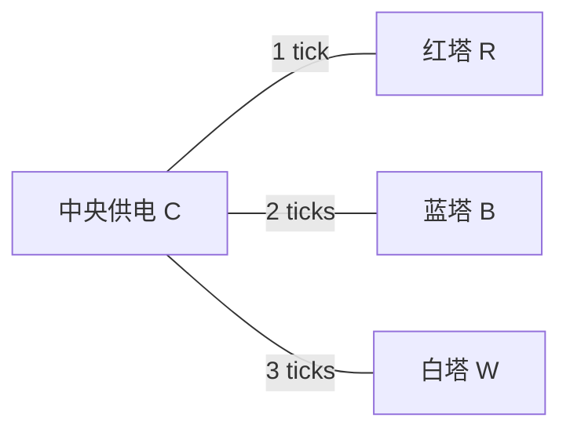

# MAP-05｜三束信号

状态：`DESIGN_COMPLETE_PENDING_RUNTIME`。本图测量在单路供电约束下，如何跨越不同距离、连续校准阶段与发射窗口安排三座灯塔。路线和窗口必须共同满足；单纯少走路可能多等，提早校准远塔可能多走路却压低空等量。

## 人工拓扑与设施

三条边均双向；除此以外没有连接。每次 `move` 只走一条边，抵达时间分别为 1/2/3 tick；旅行期间不能交互。中央 C 是唯一能切换供电目标的地点。任意时刻最多一座塔接通供电。

## 时间表与规则

| 信号 | 可发射窗口（含端点） | 校准 | 线路距离（C 往返） |
|---|---:|---:|---:|
| R 红塔 | `[15,18]` | 两个各耗 1 tick 的校准阶段 | 2 tick |
| B 蓝塔 | `[22,25]` | 两个各耗 1 tick 的校准阶段 | 4 tick |
| W 白塔 | `[29,35]` | 两个各耗 1 tick 的校准阶段 | 6 tick |

初始 `tick=0`、位置 C、三塔未校准、未发射、供电未分配。航表可从 C 用 `inspect(schedule_chart)` 查看，耗 1 tick。每次 `switch_power(station)` 只能在 C 执行，耗 1 tick，并立即把供电目标切到一座塔；人在别处时目标保持不变。校准与发射都须人在相应塔且该塔当前接电。

每塔须依序完成 `align` 与 `phase_lock` 两个校准阶段。完成校准后状态永久保留，即使随后切断供电仍可发射。`send_signal` 耗 1 tick；按动作结束 tick 检查窗口，只有该结束 tick 落在对应闭区间时发射成功。所有三个信号均发出即成功。

普通动作耗 1 tick；移动耗该边标注的 tick 数；等待每次 1 tick。动作结束后先结算动作效果，再检查窗口截止。若未发送的信号窗口结束 tick 已到或被跨过，则立即以 `SIGNAL_WINDOW_MISSED` 失败；窗口结束 tick 的 `send_signal` 先结算，因此在端点发射仍可成功。非法前置条件的动作不产生效果但仍耗 1 tick，窗口截止照常检查。失败终态后没有后续动作。

## 手写调度方案

### 方案 A：近塔优先，压低旅行与切换

先检查航表，在 R 完成校准并于 tick 15 发射；R 校准后立即发射，不在 R 上多校准。回到 C 后为 B 切电，在 B 完成校准并于 tick 22 发射。最后到 W 完成校准并于 tick 31 发射。路线旅行共 9 tick、切换 3 次、窗口等待 9 tick，结束于 tick 31。此方案少走路、少切换，但把大量可用时间花在 R 的等待上。

逐动作清单：`oracle_trace.jsonl` 中 `near_first`。等待在 R 且 R 仍接电，不会使校准衰减；该等待是有意保留的时间成本对照，不是随机延迟。

### 方案 B：远塔预校准，利用早期空档

先给 W 供电并完成校准，回到 C 后切至 R，随后依序发射 R、B。B 发射后回 C，再给已校准的 W 重新供电并发射。W 的校准跨越两次断电保留。方案结束于 tick 29，路线旅行 15 tick、切换 4 次、窗口等待 0 tick；它少用等待换取较长旅行和一次额外切换。

逐动作清单：`oracle_trace.jsonl` 中 `far_first_prep`。两条方案共用拓扑和动作规则，且在“旅行/切换成本”与“空等/完成时间”指标上取舍不同。

## 失败轨迹与指标

`failure_traces/cases.yaml` 手写三条不同错误：错把远塔预校准计划当作紧迫，校准 R 后切走供电而错过 R 窗口；把校准误认为依赖持续供电并在 R 过窗前空等；以及在 B 的校准完成后反复读取接收机状态，直到错过 B 截止。失败都用同一窗口规则，附带 `failed_station` 诊断字段。

- 主结果：是否在三个各自窗口内发出 R、B、W 三束信号。
- 调度指标：完成 tick、窗口空等 tick、移动 tick、供电切换数、各塔校准完成 tick、校准后断电持续 tick。
- 硬约束：同一时刻供电目标唯一；仅在已校准且接电的塔发射；信号不得重复发射。
- 对照：基线单路供电与仅用于消融的双路供电版本；保持拓扑、移动时间、校准流程和信号窗口一致，用以量出共享线路造成的调度代价。对照结果不与基线主能力结果混合。
- 离线基准：实现后用穷举或动态规划建立 `(completion_tick, travel_ticks, switch_count, idle_ticks)` 的 Pareto 集；本稿只确认两条手写可行轨迹，未运行求解器。

## 反换皮审查

本图的难点来自单路共享供电、跨节点长短不等的旅行成本、可保留的局部校准进度和分散在时间轴上的窗口相互制约。它不是收集三件物品：每一座塔都需接电校准、断电后保留自身进度、重新调度供电并在本塔的窗口内完成发送。MAP-04 的周期窗口不改变供电分配；MAP-06 则以天气信号价值和风险预算为核心，不复用本图排程。
