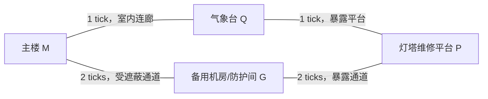

# MAP-06｜暴风眼

状态：`DESIGN_COMPLETE_PENDING_RUNTIME`。本图测“为了减少风险，要花多少时间换信息或准备防护”，而不是只看某一次猜中天气。天气由 seed 固定，预报在每个固定种子上也固定为对/错；期望值按预先定义的 seed 分布计算，不从单次结果推断能力。

## 人工拓扑与初始位置

边均双向，且没有其他连边。Agent 从 Q 开始；P 的灯塔设备损坏。M-Q 与 M-G 受遮蔽，不增加天气风险；Q-P 与 G-P 每个旅行 tick 在长暴风中增加 1 风险点，在短暴风中增加 0。移动一次只走一条边。G 可执行防护；Q 可查预报。

## 天气、预报与风险

任务已知先验 `P(短暴风)=P(长暴风)=0.5`。灯塔恢复截止 tick 14（含端点），累计风险预算为 4 点。短/长天气类型隐藏且在整局固定。预报查询耗 2 tick；查询结果本身不改风险、不改变天气。任何重复查询都返回同一信号，不增加准确度。

核心种子集为 10 个等概率固定种子，严格实现 80% 条件准确率：seed 0–3=`短暴风/预测短`，seed 4=`短暴风/预测长`，seed 5–8=`长暴风/预测长`，seed 9=`长暴风/预测短`。斜线前为裁判真值，后为预报读数；真值和 seed 映射仅裁判可见。Agent 只知道先验与准确率，查询后看见读数。

未加固的 P 点维修耗 2 tick；长暴风每维修 tick 加 3 风险点，短暴风每 tick 加 0。G 的 `harden` 操作耗 3 tick，给下一次维修加一次性 `storm_shield`，维修期间风险增量变为 0，维修后消耗。G-P 长暴风旅行仍按每 tick +1 风险，防护不遮蔽道路。任何时刻风险累计超过 4 立即失败；恰好等于 4 可继续。

初态 `tick=0, location=Q, risk=0, lamp_restored=false, storm_shield=false`。每个标准动作耗 1 tick；移动耗边标注 tick；预报查询耗 2；加固耗 3；维修耗 2。多 tick 动作内逐 tick 结算风险，越过风险预算立即终止。动作结束后先结算维修效果，再检查 `tick=14` 截止；tick 14 修复完成可成功，tick 14 尚未修好即时间失败。目标是截止前修好设备且 `risk<=4`，不要求离开任务点。

## 三种手写策略与期望值

| 策略 | 规则 | 10-seed 成功率 | 平均终止 tick | 平均风险点 | 期望效用 |
|---|---|---:|---:|---:|---:|
| 不查预报，立即修 | Q-P 后直接修 | 0.50 | 3.0 | 3.5 | 24.9 |
| 不查预报，先加固 | Q-M-G，加固后去 P 修 | 1.00 | 10.0 | 1.0 | 27.0 |
| 查预报后分支 | 预测短走 Q-P 直修；预测长走 M-G 加固路线 | 0.90 | 8.5 | 1.5 | 27.3 |

期望效用公开定义为 `U = 100 × success - 7.2 × terminal_tick - 1.0 × risk_points`，先按每个固定 seed 算出原始结果，再对十个种子取均值。风险超预算的终态 `success=0`，但仍计入终止 tick 与实际累计风险。数值仅由本设计中的手算轨迹推出，不是 Agent 实验。该权重下查预报策略只比始终加固高 0.3 分；设计刻意保留狭窄优势，Phase 1 需报告权重与先验敏感性，不能把小差异宣称为稳健定论。

`oracle_trace.jsonl` 手写了短天气立即修、长天气先加固、预测正确后的短/长两条分支。预测策略的另外两种联合事件是短天气误报长（仍可安全加固）与长天气误报短（超风险预算），两者概率和逐步成本见 `evidence_or_rules.yaml`。失败案例逐一记录了过险、误报和耗时查验。

## 对照与反换皮审查

- 对照 A：给定实际天气但不给预测，用于估计完美天气信息上界；该答案只在隔离对照组可见，不进入基线观察。
- 对照 B：不同短/长先验下维持同一 80% 条件准确率，报告期望效用随先验改变的方向；拓扑、风险方程和截止不变。
- 主测量：期望效用、成功率、累计风险、信息成本、加固成本、实际天气/预测联合类别。
- 本图以概率信号和风险阈值决定“问、赌、加固”何者合算；MAP-04 是公开周期相位推算，MAP-05 是确定性共享供电排程。本图没有复用它们的核心决策机制。
