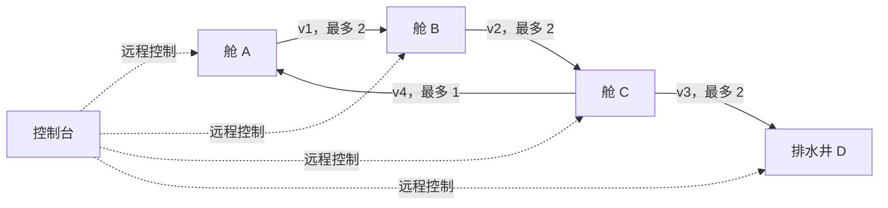

# MAP-07｜逆流阀门

状态：`DESIGN_COMPLETE_PENDING_RUNTIME`。本图测 Agent 能否预判一组串接阀门对多个舱室的联合影响。控制顺序很重要：水可以在同一 tick 内经过多个依次开放的阀；旁路 v4 在主线阀之后把剩余水送回 A。错误次序会把水集中到尚未排出的舱，而不是只多花几步。

## 水路拓扑与控制界面

水路节点不是 Agent 的行走节点；整个任务在控制台 P 远程完成。初始 `A=6, B=2, C=4, D=0`，舱室溢流阈值为 8（等于 8 安全，超过 8 失败），四阀全闭，泵关闭。D 是排水井，不参与 A/B/C 的低水胜利条件。

## 唯一流量结算定义

所有合法控制动作耗 1 tick；无效前置动作也耗 1 tick。动作效果先应用，再执行该 tick 的流水。流水按**可变水位**依次结算：

1. 若 v1 开，将 A→B，至多 2 单位。
2. 若 v2 开，将当前 B→C，至多 2 单位；它可以收到同 tick 前一步刚流入 B 的水。
3. 若 v3 开，将当前 C→D，至多 2 单位；它可以收到同 tick 前两步流入 C 的水。
4. 若 v4 开，将当前剩余 C→A，至多 1 单位；这是单向回流，不是泄压口。
5. 泵若已启动，从 D 排出至多 2 单位，消耗功率 2 单位/tick。电源每 tick 固定可供 2 单位，不另设总电量上限。

每步各舱最多按可用水量转移，不会产生负水位。流水后先检查 A/B/C 是否超过 8；再检查稳定计数：若 A/B/C 均 `≤2`，计数加一，否则清零；连续两次流水都满足即成功。无全局倒计时。`inspect(water_levels)` 显示当前值；`inspect(pipe_diagram)` 显示阀向与容量；两种读取也耗时并触发一个流水 tick，不能免费侦察。

为直接测量因果预测，可在控制台调用 `interact(control_panel, predict_next_levels, {A,B,C,D})`：该动作耗 1 tick，与等待一样结算一轮流水，裁判对提交值和真实结算值计算绝对误差。预测字段仅进裁判侧评分日志，不成为成功条件，也不读取 Agent 的 `note` 或思维链。

## 两种手工成功策略

### 策略 A：先排下游，泵全程运行

动作顺序：启动泵 → 开 v3 → 开 v2 → 开 v1 → 等待两 tick。完整逐步水位见 `oracle_trace.jsonl` 的 `downstream_first`。连续低水窗口在 tick 5 和 6 成立，tick 6 成功；泵运行 6 tick，消耗 12 功率单位。C 的峰值为初始 4。

### 策略 B：上游暂存，再启泵

动作顺序：开 v1 → 开 v2 → 开 v3 → 启动泵 → 等待四 tick。A/B/C 依次输送，短暂把 C 推到 6（仍低于溢流线）；泵只运行 5 tick，消耗 10 功率单位；连续低水窗口在 tick 7 和 8 成立，tick 8 成功。策略比 A 多 2 tick，但省 2 功率单位；代价是 C 峰值升至 6。两方案在用时/能耗与中间水位峰值上可比较。

## 失败案例与测量

`failure_traces/cases.yaml` 的三条手写失败分别造成 A、C、B 超过阈值：v4 单独回流把 A 涨到 9；开 v1/v2 却忘记开放出口 v3 使 C 涨到 10；开 v1 和 v4 但关闭 v2 让 B 涨到 10。每条都给出逐 tick 水位，便于指出具体因果误判。

- 主结果：是否让 A/B/C 连续两 tick 均降至 `≤2`，且全程未使任一舱 `>8`。
- 主测量：逐步水位预测 L1 误差、预测提交数、溢流舱与首次越界 tick、步数、泵能耗、峰值 B/C 水位。
- 对照：先验可见的完整管线图 vs 仅展示当前可读局部阀表；不隐藏真实状态、不加入随机数或不同物理规则。
- 确定性：所有数值按本节顺序流水更新；同一 seed 与动作序列必须逐步复现水位和排水量。

本图的因果机制是**一个 tick 内按指定次序即时级联的有向流量**；MAP-08 的测试/信号改变假设集合，MAP-09 的关键是跨系统资源耦合，均不复用本图水量转移方程。
