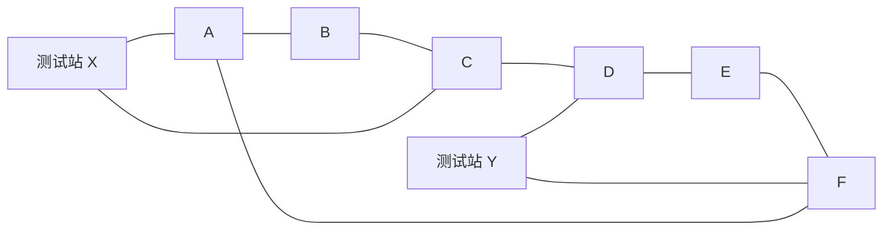

# MAP-08｜看不见的裂缝

状态：`DESIGN_COMPLETE_PENDING_RUNTIME`。本图测 Agent 如何选择能最大幅度缩小故障假设集合的压力实验，并判断何时证据足够、何时应停下实验去修复。三个候选点水位曲线、传感器底噪和房间描述起初完全相同；唯一可分辨来源是主动执行 X/Y 测试。

## 六舱环与测试站

所有边双向且单边移动 1 tick；没有其他连边。Agent 从 A 出发，携带唯一密封剂。候选泄漏舱为 B、D、F，基线先验各 `1/3`，且每局恰有一处真漏。位置名只是中性标签；房间描述、初始水位、普通传感器底噪与舱室视觉在三种真值下逐字段相同。

## 两个有损实验及唯一解码表

初始普通读数统一为 `baseline=flat`。在 X 执行 `pressure_test_X` 耗 2 tick，可区分 `{B}` 与 `{D,F}`；在 Y 执行 `pressure_test_Y` 耗 2 tick，可区分 `{D}` 与 `{B,F}`。测试确定且无噪声，结果使用没有位置含义的标记：

| 真漏 | X 测试 | Y 测试 |
|---|---|---|
| B | `pulse_amber` | `pulse_slate` |
| D | `pulse_slate` | `pulse_cobalt` |
| F | `pulse_slate` | `pulse_slate` |

只有两个结果组合才唯一指出候选：`amber/slate→B`、`slate/cobalt→D`、`slate/slate→F`。初始底噪不能代替任何一次测试。重复同一测试返回同一个脉冲，不产生新信息。

每个动作耗时期间，只要泄漏尚未修复，核心水位每 tick 增加 `0.5`；初始核心水位为 `1.0`。水位严格超过 `7.0` 时立即失败；恰好 `7.0` 仍安全。修复正确耗 1 tick，结束时封闭泄漏；修错位置耗 4 tick并消耗唯一密封剂，结束即以 `SEALANT_MISUSED` 失败。动作耗时内，泄漏先继续作用、动作效果在该动作最后一 tick 结束时提交。这是本图显式的时序规则：恰好在 tick 12 完成修复时水位达到7.0并成功；若还要多走一步则超过压力边界。

## 两棵人工决策树

### X 后 Y

从 A 到 X 只需 1 tick。若 `pulse_amber`，已唯一确定 B；若 `pulse_slate`，再走 C-D-Y 并测 Y，即可区分 D/F。B 分支最迟 tick 6 修好，D/F 分支 tick 10 修好。三种真值都通过。

### Y 后 X

从 A 经 F 到 Y 需 2 tick。`pulse_cobalt` 直接指出 D；`pulse_slate` 后走 D-C-X 测 X，再到 B/F 修复。D 分支 tick 6，B/F 分支 tick 12，后者在核心水位恰好 7.0 时完成，属于严格边界可行解。

基线均匀先验下 X-first 平均修复 tick 为 `26/3`，Y-first 为 `10`；前者更快。两者都完整成功。B 高先验控制组（`0.6/0.2/0.2`）更利于 X-first；D 高先验组（`0.2/0.6/0.2`）中 Y-first 平均 `8.4` tick，X-first 平均 `9.2` tick。这样两个实验顺序在固定基线与先验干预下都有可检验价值，而不是把其中一个写成换名的假答案。

等先验时两个首测的期望信息增益相同：初始熵 `log2(3)≈1.585 bit`，一次测试后期望剩余熵 `2/3 bit`，所以首测信息增益约 `0.918 bit`。先验变化时，信息增益与期望修复成本都须重算，不能按固定“先 X”规则评分。

## 失败轨迹与指标

`failure_traces/cases.yaml` 给出三种失败：未测试就把唯一密封剂用于错误舱、把 X 的负结果误读成阳性后修错、以及重复做已无信息增益的 X 测试导致水位在前往 F 时越过 7.0。每条都含种子、动作、泄漏增长与终止边界。

- 主结果：真漏是否被唯一密封剂正确封闭；错误维修不能重试。
- 主测量：首次测试选择、假设集大小、信息增益、测试 tick、到修复的总 tick、诊断正确率、水位峰值、错误维修率。
- 对照：无测试随机猜测作为机会基线；B/D/F 非均匀先验作为价值信息敏感性组。不能把对照组的真值写入普通观察。
- 底噪、初始传感器读数、房间名、日志长度在三种真值下逐字段一致；seed 只映射隐藏泄漏点，不改写物理规则。

本图的信息来自查询结果对候选集合的切分；MAP-07 的动作直接改变已观测水位，MAP-09 的决策要控制不同系统互相影响，不共享此二元诊断树。
