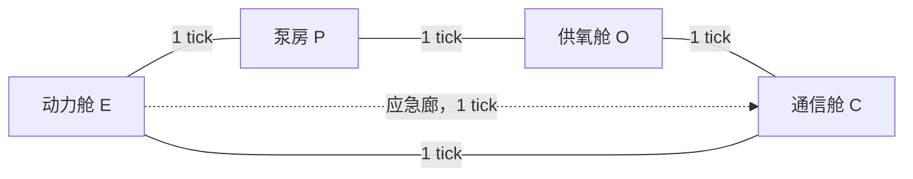

# MAP-09｜深海连锁故障

状态：`DESIGN_COMPLETE_PENDING_RUNTIME`。本图测能否同时控制漏水短路、供氧中断和有限电量，而不是逐个修好三个独立按钮。P-E 水路会把泵房水推向动力舱；泵能保住 P 却消耗刚好够发报的电量；弃置 P 则通过 E-C 应急廊更快恢复供氧和通信。

## 四节点物理拓扑

E-P-O-C 是主方形舱路；E-C 为额外的应急廊。各边双向、单边移动 1 tick。Agent 从 E 出发。泵在 P，氧气机在 O，发报台在 C，断电线路维修点在 E。

## 共享资源和耦合规则

初态 `battery=5, water_P=5, water_E=3, oxygen_reserve=12`。E-P 隔离闸初始打开，发电主线断开，供氧机关闭，泵关闭。关键顺序如下：

1. 控制类动作效果在该动作首个 elapsed tick 开始前提交；随后该动作耗时中的每 tick依序处理：若 E-P 闸开，先有 1 水单位从 P 流到 E；若当前动作为 `pump_once`，再抽 P 水；更新氧储备/稳定状态；最后检查短路与氧耗尽。`water_E>4` 当即短路失败；E 水位恰好 4 安全。多 tick 发报每 tick重复更新支持状态。
2. 在 E 执行 `isolate_compartment(P-E, mode)` 耗 1 tick。`mode=preserve` 封闸但可进入并修泵；`mode=sacrifice` 封闸并永久弃置 P，P 仍保留其水量但不再可达。两种模式都从动作结束 tick 起止漏。
3. 在 P 执行一次 `pump_once` 耗 1 tick、耗 1 电量，令 P 水位 `max(0, P-2)`。一次抽水不能连抽多个 tick；泵可在 P 水位为零时继续空转并继续耗电。
4. 在 E 修复主线耗 1 tick，要求 E 水位 `≤4`。成功后外部发电机恢复，可供氧气机用电；电池不回充。
5. 供氧机关闭期间氧储备每 tick 减 1，降到 0 即失败。主线修好后，在 O 执行 `restart_oxygen` 开机；供氧开启时稳定计数每 tick加一、氧储备不再下降。随后 `replenish_oxygen` 耗1 tick，在供氧已开时补满到12。
6. 发报台在 C。完整求救包要求供氧稳定计数至少2，并预留电池3单位；`send_distress_packet` 的门槛在调用开始时检查。电池不足3时，启动一次耗1 tick的失败校验，之后以 `INSUFFICIENT_TRANSMIT_POWER` 终止，且不扣电；门槛满足时才在开始时一次扣3电量，连续传输2 tick。传输期间必须保持供氧开启/稳定。满包发送后成功。

所有移动、操作、等待都推进对应 tick；没有免费等待或抽查。水路隔离闸与电缆走不同管沟，弃置 P 不会切断 E-C-O 应急电缆。外部发电机只负责恢复供氧线路，不替电池承担泵和发报的规定电量。这样初始五格电量形成精确权衡：保泵路线两次抽水耗2，剩3供发报；多抽一次就只剩2，达不到发报门槛。

## 两种手写成功方案

### 方案 A：保住泵房，再修复电力与供氧

在 E 以 `preserve` 封住 E-P；到 P 两次抽水把水从5降至1；回 E 修线；走应急廊到 C，再经 O 重启并补满供氧，最后回 C 发出两 tick 完整包。结束于 tick 13，电量按 `5-1-1-3=0` 精确耗尽；P 得到保全。完整状态见 `oracle_trace.jsonl` 的 `preserve_and_pump`。

### 方案 B：弃置非关键泵房，抢先恢复生命支持

在 E 以 `sacrifice` 封 P；沿 E-C 应急廊去 O 重启并补满，再到 C 发报。结束于 tick 9，电池保留2单位；代价是 P 不可恢复、仍留有5水。它少走泵房路径并保存两单位电量，换取非关键舱损失。

## 三条手写失败轨迹

`failure_traces/cases.yaml` 分别记录：E-P 漏闸持续开放两 tick导致 E 从3涨至5短路；把泵多开一 tick把电量从3耗到2，导致之后无法满足发报3格门槛；以及弃置 P 后始终不重启供氧，储备在 tick 12 归零。每条有实际动作、逐步变量和具体终止码。

- 主结果：供氧机恢复且完整求救包成功发送。
- 硬约束：E 水位不得超过4；氧储备不得耗尽；电池发送前至少3；报文传输期间供氧保持稳定。
- 测量：短路/氧气失败、抽水量、电池逐步余额、供氧储备和稳定 tick、恢复时间、弃舱代价、发送完整性。
- 对照：preserve 与 sacrifice 两种隔离模式，保持电路、漏水速率、供氧规则相同；对照差异是 Agent 主动承担的非关键舱损失。

本图的因果链是漏水→电力短路、泵→电量预算、断电→氧储备、供氧稳定→通信条件四条链彼此耦合。MAP-07 是同一流体网络内部的有序转移，MAP-08 是通过实验减少隐藏假设，都没有本图的跨系统资源循环。
