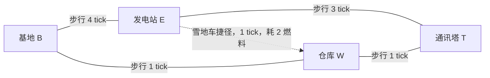

# MAP-10｜最后一桶燃料

状态：`DESIGN_COMPLETE_PENDING_RUNTIME`。本图把燃料拆成三条彼此争用、位置不同的用途：B 的燃料库维持远端基地供暖；随身燃料要送到 E 点燃发电机；E-W 雪地车捷径也从随身燃料扣款。路线的关键不是“尽可能快”，而是决定哪些燃料先离开基地、用多少时间换运输成本，以及基地热量能维持到什么时候。

## 人工固定拓扑与路程

主环为 B-E-T-W-B。E-W 是额外的短途雪地车捷径，仅这条边允许驾驶；普通边只能步行。B-E 的长坡需要4 tick，E-T 的暴露脊线需要3 tick，B-W 与 W-T 各1 tick。Agent 从 B 出发。发电机位于 E，发报台位于 T；虽然 W-T 可以很快到达塔下，但没有先在 E 启动发电机就无法发送。

## 燃料账本与结算顺序

初态 `seed=0, location=B, fuel_depot=12, carried_fuel=0, carry_capacity=5, base_temperature=5, heater_on=true, generator_online=false`。12单位燃料全部起初存放在 B 的基地燃料库。账本始终满足 `fuel_depot + carried_fuel + fuel_spent = 12`；在 B 执行一次 `load_fuel(q)` 耗1 tick，把 `q` 从基地库转入随身燃料，`q≤5`，这只是搬运，不是燃烧。基地供暖只能消耗仍留在 B 的燃料库；发电机和雪地车只能消耗随身燃料。没有远程挪用或凭空补油。

每个 elapsed tick 先推进 tick 计数并完成当前动作在该 tick 的移动/设备启动，然后处理基地热量结算，再检查失败。tick 为偶数时：若供暖开启且基地库至少有1单位，扣1并保持温度；否则供暖转为关闭，温度减1。手动关闭供暖后也在每个偶数 tick 减1。温度降到0或以下立即以 `BASE_FROZEN` 终止。供暖不升温，只把温度维持在当前值。即使 Agent 离开 B，已开启的基地供暖仍自动运行。

驾驶 E-W 单边耗1 tick、从随身燃料扣2；步行边不耗燃料。雪地车捷径可双向往返，重复穿越重复扣费。E 点启动发电机耗1 tick并燃烧随身燃料3；不足3时执行1 tick的失败启动校验，不扣燃料、不启动，随后以 `GENERATOR_FUEL_SHORTAGE` 终止。成功启动后持续给 T 发报台供电，不需要再耗燃料。T 点发送耗1 tick；发电机未启动时以 `GRID_OFFLINE` 结束，启动后只有在最后一个 tick 热量结算后基地温度仍大于0才算通信成功。

核心边界是偶数 tick 才结算供暖：tick1 的装载不烧燃料，tick2 才第一次扣款。容量5刚好覆盖一次捷径2加发电机3；若装载4，捷径后只剩2，发电动作不能成功。燃料加载、燃烧、基地供暖是同一12单位总账的分区支出，避免把“带走的燃料”和“基地还能烧的燃料”重复计算。

## 两条手写非支配成功路线

### 方案 A：步行长坡，给基地留燃料

在 B 装载3单位；沿 B-E 长坡步行4 tick，在 E 用3单位启动发电机；再步行 E-T 的3 tick并发送。供暖全程开启，偶数 tick 2、4、6、8、10各烧1单位。tick10在 T 完成通信，基地温度保持5，基地库剩4、随身燃料0。总用燃料8，完成较慢但比驾驶路线多留1单位燃料。

### 方案 B：仓库折返，雪地车压缩路程

在 B 装载5单位；步行 B-W 1 tick，从 W 驾驶 E-W 捷径1 tick（扣2），到 E 恰余3并启动发电机；步行 E-T 3 tick后发送。供暖偶数 tick 2、4、6、8烧4单位。tick8通信成功、基地温度5、基地库余3、随身0。它比步行路线快2 tick，但为捷径多花2单位，仅通过少烧1单位供暖燃料抵消一部分，最终少留1单位。两者在“完成 tick / 剩余燃料 / 最低基地温度”上互不支配。

完整逐动作状态见 `oracle_trace.jsonl` 中的 `walk_keep_fuel` 与 `snowmobile_shortcut`。两条路线都先供电再发送，差异来自长坡步行与燃料承载捷径，而不是换皮参数。

## 三条具体失败轨迹

`failure_traces/cases.yaml` 手写记录：

1. 只装4单位就驾驶捷径，抵达 E 时剩2，启动发电机的1 tick门槛校验后失败；
2. 在 B 关闭供暖后仍选长坡步行，虽然发电机已启动，但基地温度在 tick10 的终点检查降到0；
3. 先装载5单位却在 B 空等16 tick，基地库存耗尽，随后按快速路线前进，最终仍在发报完成时因基地冻结失败。

三种失败分别暴露运输/发电的精确燃料下限、慢路线需要热量支撑、长时间等待会把“已留在基地的燃料”烧空。不能用一个通用倒计时替代这三类资源因果。

## 设计测量与对照

- 主结果：T 发报成功且基地温度始终大于0。
- 多目标测量：完成 tick、总燃料结余、基地燃料库结余、随身燃料、最低基地温度、捷径燃料成本、供暖消耗。
- 因果对照：保持同一初态与供暖规则，对比长坡步行和 W-E 雪地车捷径；逐 tick 账本明确展示“快2 tick但多花2油、少烧1油”的净效应。
- 防作弊：Agent 只能获得当前燃料位置、温度、供暖状态、路线、发电机状态；固定种子0，不向 Observation 提供未来热量结算或 Oracle 行动。

这张图考察一个物理燃料池被分仓后如何分配：路线油不能再拿去给基地供暖，基地油也不能隔空送到发电机。它与 MAP-09 的电池/氧气耦合不同；这里没有故障连锁，核心是燃料的运输位置、时间和热损失。
