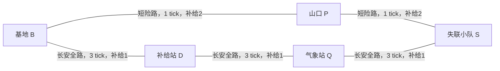

# MAP-11｜失联的小队

状态：`DESIGN_COMPLETE_PENDING_RUNTIME`。这是一道有噪声预报的风险策略题：山口短路能更早抵达队员，但四次穿越都要付补给并抽取冻伤事件；经补给站和气象站的长路免受暴风抽签，却慢得多。侦察只改变对未来暴风的概率判断，不揭开本 seed 的暴风序列。救到人以后，返程每一段都因负重多花1 tick。

## 两条物理上分离的路线

两条路除 B、S 外不相接。Agent 从 B 出发，队员在 S。短路有 B-P、P-S 两段；长路有 B-D、D-Q、Q-S 三段。长路虽每段多走几 tick，但经过的都是背风地形；短路两段均暴露在山口风道。负重返程把每段移动时间加1 tick：短路返程每段2 tick，长路返程每段4 tick；返程补给仍按该路段原本的每段费用支付，不另加补给。提纲的“返程成本+1”在本图中明确解释为每段额外1 tick。

## 初态、体温、补给与队员计时

`seed` 初始抽自固定的10个均匀权重手工审计 seed；`location=B`，基地补给箱8、Agent随身0/容量8；Agent体温10，队员体温10，队员生命计时15；当前天气 `clear`。两人体温沿用提纲给定的10作为共同初值。`resupply(q)` 在 B 耗1 tick，把 `q` 单位从基地箱转入随身包，不制造或消耗补给；短路完整往返要8单位，长路往返要6单位。长路方案可只带6，留2在 B。

队员计时每个 elapsed tick 减1，直到救援动作成功完成才停止；降到0先于该 tick 的救援提交结算并以 `TEAM_LIFE_EXPIRED` 终止。救援在 S 耗1 tick。任务须把 Agent 和队员都带回 B，且两人体温始终大于0。救援完成后的计时已停止，但返回路上的天气、负重和体温仍持续结算。

## 冷暴露与分段风险

每次穿越短路的一段，穿越者先承受基础 `−1` 体温；若该段命中暴风，再额外 `−5`。B-P出发时队员仍在 S，不承受B-P上的伤害；P-S出发时队员在 S 暴露于抵达风口，双方都可能受该次暴风伤害。救援后两人同行，返程短路每次命中都同时作用于两人。任一人体温降到0或以下立即 `BODY_HEAT_DEPLETED`。短路四次穿越共有四个隐藏、独立的未来暴风抽签；每次到达后当前天气变化对Agent可见，尚未抽取的结果不可见。

长安全路每段走完只让实际行进者体温 `−1`，无暴风抽签；救援后的三段返程因此使双方体温各降3。D、Q、B为避风点。`rest` 只能在 B/D/Q 使用，耗1 tick和随身补给1，使当前在场者体温 `+2`（上限10）；队员未获救时不在这些站点，休息不会给其回血，但生命计时仍减少。休息提供温度恢复，却会挤占队员的救援时间和有限补给。

每个动作开始时检查地点与资源；合规移动开始即扣该段补给，按边耗时推进。抵达边末先更新天气/冻伤与体温，再检查体温失败。队员计时每 tick 先减，再在救援动作完成时检查是否还有正值；因此救援开始前剩1，完成 tick 归零时仍会先失败。侦察和补给发生在 B 避风点时不改变体温，但仍推进队员生命计时。

## 明确的风暴概率，不泄漏 seed 真值

隐藏气象态 `quiet` 与 `unstable` 的先验各为 `0.5`。四次短路穿越在同一隐藏态下条件独立：quiet 时每次 `p=0.10`，unstable 时 `p=0.60`，所以未侦察下一段的边际先验为 `0.35`。`scout` 在 B 耗2 tick，只返回噪声信号 `falling` 或 `rising`：`P(rising|unstable)=0.8`、`P(rising|quiet)=0.2`。Bayes 更新后 rising 的隐藏态后验为0.8，下一段暴风概率为0.5；falling 的后验为0.2，下一段暴风概率为0.2。信号不确定，也不透露任何逐段暴风结果。

经过一段后，Agent能看到当地天气并据此再次更新隐藏态后验：命中暴风时 `P(unstable|storm)=0.6u/(0.6u+0.1(1-u))`；未命中时 `P(unstable|clear)=0.4u/(0.4u+0.9(1-u))`，其中 `u` 是该段前的 unstable 后验；下一段 forecast 始终为 `0.1+0.5u`。这避免把当前天气可见与未来概率判断割裂。

四次短路穿越中，两次及以上暴风会使Agent总体体温损失至少 `4 + 2×5 = 14`，从10降至0以下；零次或一次暴风可活着返回，单次命中在首段、P-S、两段返程的任何位置都逐步复核过双方仍大于0。令 `r(p)=(1-p)^4+4p(1-p)^3`。在固定隐藏气象态下，quiet 的成功率 `r(0.1)=94.77%`，unstable 的 `r(0.6)=17.92%`；未侦察先验成功率为 `0.5r(0.1)+0.5r(0.6)=56.345%`。falling 后混合成功率 `0.8r(0.1)+0.2r(0.6)=79.40%`；rising 后若仍走短路仅 `0.2r(0.1)+0.8r(0.6)=33.29%`。侦察自适应策略在 falling 走短路、rising 走长路的解析成功率为 `0.5×0.794+0.5×1=89.70%`，代价是侦察多花2 tick。

`weather_seed_fixture.yaml` 给出10个均匀权重、手工分层的确定性审计 seed：低/高气象态的逐边命中率分别精确为0.10/0.60，`rising` 的态内比例分别为0.20/0.80；同时包含错误信号与相反风暴序列，不能把某一次侥幸当成侦察能力。实际观察到每段 clear/storm 后，forecast 也按上式递推。有限 fixture 的短路成功率为5/10，自适应策略为9/10（seed 8 是 falling 假阴性），长路为10/10。它是纸面回放夹具，不是 Agent benchmark 实验。

## 手写的三种成功计划

### 快速短路，不侦察（seed 0）

B 装载8，走 B-P、P-S 并立即救援，再背负队员走 S-P、P-B。seed0的四个暴风位均为0。救援发生在 tick4，队员生命余11；到 B 于 tick8，补给耗8。Agent 四段各降1至6，队员在 S 接受 P-S 的1点冷损、返程两段各降1至7。快，但任意两段暴风都会使旅程失败。

### 侦察后按信号分流（seed 0展示 falling 分支）

B 侦察2 tick得 `falling / p=0.20`，再装载8，走短路并返回。救援在 tick6时队员余9，tick10抵 B；四段无暴风，最终两人体温6/7。对 rising 信号改用下述长路：虽然较慢，能把风暴风险从行路条件中移除。有限seed审计仍有falling假阴性，故侦察不是保险。

### 走长安全路，预留补给（seed 7）

B只装载6，侦察得 `rising / p=0.50`，走 B-D-Q-S 三段，在 tick13完成救援，队员生命余2；再以负重4 tick/段返 B，于 tick25完成。总补给耗6，基地箱留2；无风暴，Agent体温最终4、队员7。若计划更重视体温，可多带2单位并在 Q、D各休息一次，额外消耗2补给、延后2 tick，但会恢复两人体温。

## 风险调整效用与对照边界

每个 seed 记录风险调整效用 `U = 100×I(Agent与队员安全回到B) − 2×救援时刻tick − 已耗补给`；未能救出时救援时刻取终止tick，避免失败样本免费。跨10个均匀审计 seed 报平均 U、完整往返率、救援时刻、剩余生命计时、补给耗量和两人体温最低值。解析概率与有限seed fixture分开报告；仅有纸面手工 seed 表，不报告模型成绩。

该图和 MAP-06 的已知天气先验效用选择不同：这里风险被实际短路线冻伤和队员生命窗口共同约束，侦察信号还会出错；和 MAP-10 的燃料守恒也不同，本图资源按路线段消耗，重要变量是四次相关决策中的风险暴露、救援窗口和负重返程。
