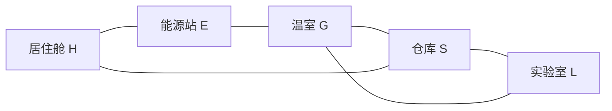

# MAP-12｜极夜三十天

状态：`DESIGN_COMPLETE_PENDING_RUNTIME`。本图不是一次性把资源凑齐，而是把30天按顺序排班：燃料要先留给每天的供暖，再负担温室的连续供能；食物收成必须沿站点逐段送回居住舱；零件要提前从仓库运到能源站，赶上每7天的控制器磨损；实验室还要连续做满四轮三日研究。每天只有两个劳动动作槽，维修、转运和研究会直接争同一份日历。

## 固定拓扑与物资位置

基地依次连接 H-E-G-S-L，另有 H-S 与 G-L 两条支线。人员由分驻各站的工作组执行计划；移动工作组不占动作槽，**物资**仍必须沿一条相邻边逐段转运。S→G→E 是零件去维修的两段路线；G→E→H 是食物回居住舱的两段路线。每条边每个劳动动作最多搬零件2或食物5，不能跨站传送。

初态 `seed=0, day=0, fuel_E=40, food_H=30, food_G=0, food_E=0, parts_S=8, parts_G=0, parts_E=0`。燃料集中在 E 的能源库，热网直接把燃料供给 H 的独立炉；温室每个有效供能日另耗燃料1。控制器负责温室/实验室配电，不切断 H 的独立供暖炉。燃料转运不在本图开放，避免把集中燃料变成额外运料题。

## 日结算顺序与失败边界

每天开始时，日号7、14、21、28触发控制器磨损并暂时断开 G/L。该日 `repair_controller` 必须在 G/L 工作之前执行：它在 E 占1动作槽、花 parts_E=2，修复后本日即可重新供电；没有维修时控制器保持离线，温室进度清零、研究日不计入连续串。磨损不会让独立炉停转。

磨损结算后按计划顺序执行0–2个劳动动作：`set_heating(on/off)`、`start_greenhouse_power`、`plant_batch`、`research`、`repair_controller` 或沿单边 `transfer`。每项各占1槽。供暖初始开启且保持开启时，日末自动烧 fuel_E=1；关闭供暖或当日无燃料都记一次 heat-shortage day，连续两天失败。温室开启且控制器在线时日末另烧燃料1，并为已种批次累计一个 powered day；中断或断电会把连续数清零。第三个连续 powered day收获5食物到 G 并自动关温室。居住舱每日随后领取1份食物；H 库存为0时记一次 food-shortage day，连续两天失败。食物转运在该日配给前完成。

研究动作须在控制器在线的 L 执行。连续三个日结算都执行 `research` 才得到3积分并清零研究串；漏一天或控制器离线就把研究串归零。day30日结算后只有存活且 research_points≥12才成功；活过30天但研究不足以 `RESEARCH_TARGET_MISSED` 结束。达成12分需要四段完整三日研究串，单纯熬过日历不算完成。

维修包数恰好为四次磨损所需：8零件从 S 每包2单位，两段各一次转运，维修消耗2；不能在一个动作中从 S 直接修 E。温室进度和研究进度都按连续日计算，不能把中断的零散工作天数相加。

## 手工方案 A：研究优先、只建一批粮

day1在两个槽中依次启动温室供能、种下第一批；日1–3连续供能，day3收5食物。day2–13连续做12个研究日，分别在day4、7、10、13结算3分，合计12。day7维修必须排在研究前，不能让控制器离线打断这条研究串。零件批次按 day2/3、day4/5、day11/12、day25/26 的 S-G-E 两段路径准备，并在day7/14/21/28各维修一次。收成day6从G转E、day8从E转H。所有日最多2动作；完整逐日状态见 `oracle_trace.jsonl` 的 `research_priority`。

30天燃料账：供暖30 + 温室3 = 33，E余7。食物账：H初始30 + 收成5 − 日配30 = 5；day30结束仍有5。四次维修恰耗parts8，研究12，食物/供暖欠供连续日均为0。此方案把可用动作集中到较早的研究串，留7燃料余量。

## 手工方案 B：粮食安全垫优先

第一批仍在day1–3，第二批在day4重新启动并于day6收成。第一批day5/6经 G-E-H 回H；第二批day7/8经 G-E-H 回H。研究改排在day10–21，day12、15、18、21各结算3分。维修零件包改为day2/3、day8/9、day15/16、day22/23到达E，仍在7/14/21/28维修。day8可把第二批食物转E-H，同时把下一维修包S-G，两项正好占满日槽。

这条手写备选路线多做一批温室，day30 H余粮10；燃料多耗3，余4；维修、研究和生存约束仍满足。它用燃料余量换更厚的食物缓冲，与方案A不是同一日历换皮。

## 三条手写失败轨迹

`failure_traces/cases.yaml` 记录三个独立失效方式：

1. 连续两天关闭供暖：即使燃料箱有余量，也连续记热欠供，在day2失败。
2. day1–15每天从 H 向 S 转出1份食物，再照常日配；H 在day15降为0，day16/17连续无口粮，于day17失败。
3. 保持控制器可用且每次day7磨损都送零件维修，但只在两日短串做研究，隔日停工；没有一串达到3天，day30积分仍为0，研究目标失败。

三者分别锁定供暖日程、库存转运导致的口粮连续短缺，以及研究连续性。失败不是一个统一30日倒计时。

## 风险、测量与因果对照

- 主要结果：存活满30日且研究积分至少12。
- 每日记录：燃料、H/G/E食物、S/G/E零件、供暖欠供串、断粮欠供串、控制器状态/磨损、温室连续供能天数、研究连续天数/积分、劳动动作槽。
- 因果对照：方案A只收一批粮，留更多燃料；方案B多收一批粮，燃料余量少3。比较库存波动与最终安全垫，而不是只比较是否通关。
- 固定 seed0，无随机事件；重置同seed并重放同一逐日动作表，应得到逐日相同状态。当前只做手算和离线可行性排程，不报告模型成绩。
